# Learn Hono 🔥

<div align="center">

[](https://opensource.org/licenses/MIT)
[](https://hono.dev)
[](https://github.com/TheLearningHubOrg/learn-hono/actions/workflows/ci.yml)
[](https://github.com/TheLearningHubOrg/learn-hono/releases)
[](https://hono.dev/docs/concepts/web-standard)
[](https://hono.dev/docs/getting-started/basic)

**From zero to staff-level Hono: one Web Standards app that runs on Node.js, Bun, Deno, Cloudflare Workers and AWS Lambda.**  
Routing, middleware, validation with Zod, typed context, JSX server rendering, the RPC client, testing with `app.request()`, router internals and multi-runtime deployment.

[Getting Started](#1-stage-1-foundations-setup-runtimes--the-request-lifecycle) • [Routing](#2-stage-2-routing-handlers--responses) • [Validation & Data](#3-stage-3-validation-typed-context--the-data-layer) • [Middleware & Auth](#4-stage-4-middleware-authentication--dependency-injection) • [RPC & Testing](#5-stage-5-apis-the-rpc-client--testing) • [Production](#6-stage-6-runtimes-performance-security--deployment) • [Interview Prep](#7-stage-7-staff-hono-backend-engineer-interview-handbook--cheatsheet)

<br/>

<a href="https://www.buymeacoffee.com/manthanank">
  
</a>

</div>

---

> **Language of the examples: TypeScript.** Hono is written in TypeScript and its main selling points (typed `c.var`, `c.req.valid()`, the `hc` RPC client) only exist at the type level. Every example, the starter project and its tests are TypeScript, compiled with `tsc` for Node.js and runnable unchanged on Bun, Deno and Workers.

## 🗺️ 7-Stage Pedagogical Roadmap


| Stage | Focus Domain | Core Concepts & Engineering Outcomes |
| :--- | :--- | :--- |
| **Stage 1** | **Foundations: Setup, Runtimes & the Request Lifecycle** | `npm create hono@latest`, `new Hono()`, `app.fetch`, the Context object `c`, `@hono/node-server`'s `serve()`, entry files for Bun, Deno, Workers and Lambda, testing with `app.request()`. Outcome: a running, tested API on Node.js that you can move to another runtime by swapping one file. |
| **Stage 2** | **Routing, Handlers & Responses** | `app.get/post/on/all`, `:param{regex}`, optional `:param?`, wildcards, `c.req.query/queries/parseBody`, `app.route()`, `basePath()`, route precedence, `c.json/text/html/body/redirect`, `hono/jsx` views, `streamText`/`streamSSE`, SmartRouter. Outcome: a full resource API plus server-rendered HTML pages. |
| **Stage 3** | **Validation, Typed Context & the Data Layer** | `hono/validator`, `@hono/zod-validator` with Zod 4, Standard Schema validators, `c.req.valid()`, `Bindings` and `Variables` generics, `createMiddleware`, `HTTPException`, `app.onError`, repository pattern injected through `c.set()`, Drizzle on D1 or Postgres, migrations, `contextStorage`. Outcome: every input is parsed before your handler runs and storage can be swapped without touching routes. |
| **Stage 4** | **Middleware, Authentication & Dependency Injection** | Onion model internals, `createMiddleware`, `combine`, `every`/`some`, built-in `cors`, `csrf`, `secureHeaders`, `bodyLimit`, `jwt`, `jwk`, `bearerAuth`, `basicAuth`, `createFactory`, `executionCtx.waitUntil()`. Outcome: authenticated, rate-limited routes with reusable middleware stacks. |
| **Stage 5** | **APIs, the RPC Client & Testing** | `hc<AppType>()`, `InferRequestType`/`InferResponseType`, `parseResponse`, `@hono/zod-openapi`, SSE and WebSockets, `testClient`, Vitest with the Workers pool, contract tests. Outcome: a typed client and server shipped from one monorepo with an OpenAPI document. |
| **Stage 6** | **Runtimes, Performance, Security & Deployment** | Wrangler deploys, Bun and Deno servers, Lambda `handle()`, Docker on Node 24, `cache`, `etag`, `compress`, `timeout`, connection info, logging and tracing, cold starts and bundle size. Outcome: the same app deployed to two runtimes behind CI. |
| **Masterclasses** | **Router internals, RPC at scale, JSX streaming, edge data, flagship blueprint** | How RegExpRouter compiles one regex, keeping RPC type-check time flat in large apps, Suspense streaming and client components, D1/KV/Durable Objects with Drizzle, and an end-to-end multi-runtime service. |
| **Stage 7** | **Staff Interview Handbook** | 40+ interview Q&As across internals, architecture and debugging scenarios, plus a one-page cheatsheet. |

---

## 🆕 Hono Versions, What's New & Migration

### V.1 Release Timeline

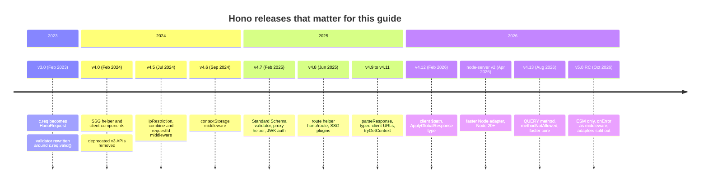

### V.2 Compatibility Matrix

| Hono | Released | Status (Nov 2026) | Node.js | Other runtimes | Companion packages used here | Notes |
| --- | --- | --- | --- | --- | --- | --- |
| **4.13.x** | Aug 2026 | Current stable, targeted by this guide | 20+ with `@hono/node-server` 2.x; this repo pins 22.12+ | Bun, Deno, Cloudflare Workers, Fastly, Vercel, Netlify, AWS Lambda | `@hono/node-server` 2.1, `@hono/zod-validator` 0.9 (Zod 4), TypeScript 7.0, Vitest 5 | Ships both ESM and CommonJS. |
| 5.0.0-rc | Oct 2026 | Release candidate, not for production yet | 22.12+ (ESM only) | Same, but adapters come from `@hono/<runtime>` packages | Same | See V.4 for the changes to prepare for. |
| 4.0 to 4.12 | Feb 2024 to Feb 2026 | Superseded by 4.13 | 18+ with `@hono/node-server` 1.x | Same | `@hono/node-server` 1.19 | Minor releases are backwards compatible; upgrade in place. |
| 3.x | 2023 | End of life | 18 | Same | `@hono/node-server` 1.x | Move to 4.x using the v4 notes in V.5. |

The core `hono` package has no dependencies. Runtime support comes from the Web Standards APIs (`Request`, `Response`, `Headers`, `URL`, `ReadableStream`, Web Crypto) that every listed runtime implements. Node.js is the one runtime that needs an adapter, because its `http` module predates `fetch`.

### V.3 What's New in 4.13

#### First-class `QUERY` method

`QUERY` is a proposed HTTP method that is safe and idempotent like `GET` but carries a request body, which suits search endpoints whose filters do not fit in a URL. Hono 4.13 adds `app.query()` and teaches the cache, ETag and CORS middleware about it.

```ts
// Before 4.13: register the method by name, and remember CORS does not allow it by default
app.on('QUERY', '/search', async (c) => c.json(await search(await c.req.json())));

// 4.13: a dedicated method, typed like the others, allowed by cors() out of the box
app.query('/search', async (c) => c.json(await search(await c.req.json())));
```

#### `methodNotAllowed` middleware

Before 4.13 a request to a known path with the wrong method fell through to `notFound()` and returned 404. The new middleware returns `405 Method Not Allowed` with an `Allow` header, which is what HTTP clients and API gateways expect.

```ts
// Before: hand-written, and easy to forget when you add a method
app.all('/hello', (c) => c.text('Method Not Allowed', 405, { Allow: 'GET, POST' }));

// 4.13
import { methodNotAllowed } from 'hono/method-not-allowed';

app.use(methodNotAllowed({ app }));
app.get('/hello', (c) => c.text('hi'));
// DELETE /hello -> 405, Allow: GET, HEAD
```

The starter's [tests/routing.test.ts](tests/routing.test.ts) pins this behaviour.

#### RegExpRouter rejects unsupported paths at registration

RegExpRouter compiles every route into one regular expression. Some combinations cannot be compiled, and SmartRouter then falls back to TrieRouter. Since 4.13 that detection happens when routes are registered rather than on the first request, so the first user no longer pays the cost and a misconfigured router fails at startup.

#### `routePath()` and `matchedRoutes()` helpers

`c.req.routePath` and `c.req.matchedRoutes` are deprecated in favour of functions from `hono/route` (added in 4.8, and the properties are removed in v5).

```ts
// Before (deprecated)
app.get('/posts/:id', (c) => c.json({ route: c.req.routePath }));

// Now
import { routePath } from 'hono/route';

app.get('/posts/:id', (c) => c.json({ route: routePath(c) })); // "/posts/:id"
```

#### `@hono/node-server` 2.x

The Node.js adapter's second major version keeps the same `serve()` API and is markedly faster, mostly on body-heavy requests. It requires Node.js 20 or later and drops the `@hono/node-server/vercel` entry point, because Vercel's current runtimes run a default-exported Hono app directly.

```ts
// Unchanged between 1.x and 2.x
import { serve } from '@hono/node-server';

serve({ fetch: app.fetch, port: 8080, hostname: '0.0.0.0' });
```

### V.4 Migration Guide (4.x → 4.13, then preparing for 5.0)

Upgrading inside 4.x has no breaking changes. Do it first, fix deprecation warnings, then you are a small step from v5.

```bash
# 1. Upgrade within the 4.x line
npm install hono@^4.13 @hono/node-server@^2 @hono/zod-validator@latest zod@^4

# 2. Make sure the Node version satisfies the adapter (20+) and, for v5, 22.12+
node --version

# 3. Find the APIs that v5 removes
grep -rnE "c\.req\.(routePath|matchedRoutes)|app\.(mount|fire)\(|from 'hono/(bun|deno|cloudflare-workers|cloudflare-pages|aws-lambda|lambda-edge|vercel|netlify|service-worker)'" src

# 4. Type-check and test
npx tsc --noEmit && npm test
```

When you move to 5.0, these are the edits, in order of how often they bite:

1. **ESM only.** `hono` no longer ships CommonJS. Set `"type": "module"` (this repo already does) or rely on Node 22.12+ being able to `require()` ES modules.
2. **`onError` becomes middleware.** `app.onError((err, c) => ...)` becomes `app.onError((c) => ...)` and the error is read from `c.error`. Several `onError` and `notFound` registrations now compose instead of replacing each other, and they can take a path, for example `app.notFound('/api/*', handler)`.
3. **Runtime adapters move out.** `hono/bun`, `hono/deno`, `hono/cloudflare-workers`, `hono/aws-lambda`, `hono/lambda-edge`, `hono/vercel`, `hono/netlify` and `hono/service-worker` become `@hono/<runtime>` packages. `hono/cloudflare-pages` is gone; use Workers with static assets.
4. **Stricter request types.** `c.req.json()` returns `Promise<unknown>`, and `c.req.query()` without a key returns values typed `string | undefined`. Validators already give you typed data, so code that uses `c.req.valid()` is unaffected.
5. **Unified wildcards.** A `*` at the end of a segment behaves the same in every router; a lone `*` segment matches exactly one non-empty segment.

```ts
// 4.13 (this repo)
app.onError((err, c) => c.json({ message: err.message }, 500));

// 5.0
app.onError((c) => c.json({ message: c.error?.message ?? 'error' }, 500));
```

### V.5 Deprecations & Breaking Changes

| Version | Deprecated / removed | Replacement | What breaks and how to fix it |
| --- | --- | --- | --- |
| 3.0 | `c.req` was the raw `Request` | `c.req` is `HonoRequest`; the raw object is `c.req.raw` | Code reading `c.req.headers` or `c.req.cf` must use `c.req.raw.headers`, `c.req.raw.cf`. |
| 3.0 | `serveStatic` from the core | Per-runtime `serveStatic` (`@hono/node-server/serve-static`, `hono/bun`, ...) | Import from the adapter for your runtime. |
| 4.0 | `c.jsonT()`, `c.stream()`, `c.streamText()` | `c.json()`, `stream()` / `streamText()` from `hono/streaming` | Calls fail at compile time; switch to the helpers. |
| 4.0 | `app.showRoutes()`, `app.routerName` | `showRoutes()`, `getRouterName()` from `hono/dev` | Pass the app as an argument. |
| 4.0 | `app.head()` | Nothing: `app.get()` answers `HEAD` too | Delete explicit HEAD routes. |
| 4.0 | `c.req.cookie()` | `getCookie()` from `hono/cookie` | Import the helper. |
| 4.0 | `hono/nextjs` | `hono/vercel` (`handle(app)`) | Change the import path. |
| 4.4 | Publishing to `deno.land/x` | JSR: `jsr:@hono/hono` | Update Deno import maps. |
| 4.8 (deprecated), 5.0 (removed) | `c.req.routePath`, `c.req.matchedRoutes` | `routePath(c)`, `matchedRoutes(c)` from `hono/route` | Property access is undefined in v5. |
| 4.x (deprecated), 5.0 (removed) | `app.mount()`, `app.fire()` | `mount()` from `hono/mount`; `fire()` from the service-worker adapter | `app.all('/legacy/*', mount(other.handle))`. |
| 5.0 | CommonJS build | ESM only | `require('hono')` needs Node 22.12+; bundlers must emit ESM. |
| 5.0 | `onError((err, c) => ...)` | `onError((c) => ...)` reading `c.error` | Type error on the old signature. |
| 5.0 | `hono/<runtime>` adapters, `hono/cloudflare-pages` | `@hono/<runtime>` packages; Workers static assets | Install the package and change imports. |
| 5.0 | `c.req.json()` typed `any` | Typed `unknown` | Pass a type argument or validate. |
| 5.0 | `c.json(undefined)` returned an empty body | Throws `TypeError`, like `Response.json()` | Return `c.body(null, 204)` for "no content". |

---

## 📋 Table of Contents

- [🆕 Hono Versions, What's New & Migration](#-hono-versions-whats-new--migration)
- [1. Stage 1: Foundations: Setup, Runtimes & the Request Lifecycle](#1-stage-1-foundations-setup-runtimes--the-request-lifecycle)
  - [1.1 What Hono Is and the Problem It Solves](#11-what-hono-is-and-the-problem-it-solves)
  - [1.2 Installation & First Run](#12-installation--first-run)
  - [1.3 Line-by-Line Breakdown of the Starter Project](#13-line-by-line-breakdown-of-the-starter-project)
  - [1.4 The Request Lifecycle](#14-the-request-lifecycle)
  - [1.5 The Context Object `c`](#15-the-context-object-c)
  - [1.6 One App, Many Runtimes](#16-one-app-many-runtimes)
  - [1.7 Testing Without a Server](#17-testing-without-a-server)
  - [1.8 Composition Root and Project Layout](#18-composition-root-and-project-layout)
  - [1.9 Pitfalls](#19-pitfalls)
  - [1.10 Best Practices](#110-best-practices)
  - [1.11 Hands-on Exercise](#111-hands-on-exercise)
- [2. Stage 2: Routing, Handlers & Responses](#2-stage-2-routing-handlers--responses)
  - [2.1 Defining Routes and HTTP Methods](#21-defining-routes-and-http-methods)
  - [2.2 Path Parameters, Regex Constraints, Optional Segments and Wildcards](#22-path-parameters-regex-constraints-optional-segments-and-wildcards)
  - [2.3 Reading the Request: Query, Headers and Body](#23-reading-the-request-query-headers-and-body)
  - [2.4 Route Order and Precedence](#24-route-order-and-precedence)
  - [2.5 Grouping: `route()`, `basePath()` and Sub-Apps](#25-grouping-route-basepath-and-sub-apps)
  - [2.6 Building Responses](#26-building-responses)
  - [2.7 Server-Rendered HTML with `hono/jsx`](#27-server-rendered-html-with-honojsx)
  - [2.8 Streaming Responses](#28-streaming-responses)
  - [2.9 Which Router Runs Your Routes](#29-which-router-runs-your-routes)
  - [2.10 Pitfalls](#210-pitfalls)
  - [2.11 Best Practices](#211-best-practices)
  - [2.12 Hands-on Exercise](#212-hands-on-exercise)
- [3. Stage 3: Validation, Typed Context & the Data Layer](#3-stage-3-validation-typed-context--the-data-layer)
  - [3.1 The Validator Middleware Model](#31-the-validator-middleware-model)
  - [3.2 `hono/validator` Without a Schema Library](#32-honovalidator-without-a-schema-library)
  - [3.3 Zod 4 with `@hono/zod-validator`](#33-zod-4-with-honozod-validator)
  - [3.4 Typing the Environment: Bindings and Variables](#34-typing-the-environment-bindings-and-variables)
  - [3.5 Error Handling: `HTTPException`, `onError` and `notFound`](#35-error-handling-httpexception-onerror-and-notfound)
  - [3.6 The Repository Pattern and Dependency Injection Through Context](#36-the-repository-pattern-and-dependency-injection-through-context)
  - [3.7 Real Persistence: Drizzle on D1 or PostgreSQL](#37-real-persistence-drizzle-on-d1-or-postgresql)
  - [3.8 Migrations and Schema Evolution](#38-migrations-and-schema-evolution)
  - [3.9 Request-Scoped State Without Passing `c` Around](#39-request-scoped-state-without-passing-c-around)
  - [3.10 Pitfalls](#310-pitfalls)
  - [3.11 Best Practices](#311-best-practices)
  - [3.12 Hands-on Exercise](#312-hands-on-exercise)
- [4. Stage 4: Middleware, Authentication & Dependency Injection](#4-stage-4-middleware-authentication--dependency-injection)
- [5. Stage 5: APIs, the RPC Client & Testing](#5-stage-5-apis-the-rpc-client--testing)
- [6. Stage 6: Runtimes, Performance, Security & Deployment](#6-stage-6-runtimes-performance-security--deployment)
- [M1. Masterclass: Router Internals](#m1-masterclass-router-internals)
- [M2. Masterclass: End-to-End Type Safety with RPC at Scale](#m2-masterclass-end-to-end-type-safety-with-rpc-at-scale)
- [M3. Masterclass: JSX Streaming, Suspense and Client Components](#m3-masterclass-jsx-streaming-suspense-and-client-components)
- [M4. Masterclass: Edge Data with D1, KV and Durable Objects](#m4-masterclass-edge-data-with-d1-kv-and-durable-objects)
- [M5. Masterclass: Flagship Blueprint: A Multi-Runtime Production API](#m5-masterclass-flagship-blueprint-a-multi-runtime-production-api)
- [7. Stage 7: Staff Hono Backend Engineer Interview Handbook & Cheatsheet](#7-stage-7-staff-hono-backend-engineer-interview-handbook--cheatsheet)
  - [7.1 Core Concepts (Q1-Q2)](#71-core-concepts-q1-q2)
  - [7.5 Staff Cheatsheet](#75-staff-cheatsheet)
- [🧪 Example Projects](#-example-projects)
- [📝 Cheat Sheets](#-cheat-sheets)
- [📚 Resources](#-resources)
- [🤝 Contributing](#-contributing)
- [📄 License](#-license)
- [🙏 Acknowledgments](#-acknowledgments)
- [🌐 Connect with me](#-connect-with-me)
- [☕ Support](#-support)

---

## 1. Stage 1: Foundations: Setup, Runtimes & the Request Lifecycle

This stage covers what Hono is, how to create and run a project, and what happens between a TCP connection and your handler. You need Node.js 22.12 or later and basic TypeScript. By the end you can run, test and explain every line of the starter project, and move it to Bun, Deno or Cloudflare Workers by changing only the entry file.

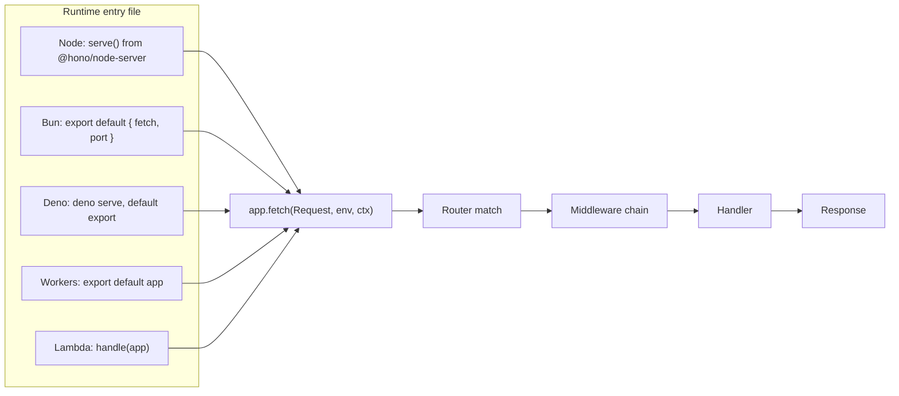

### 1.1 What Hono Is and the Problem It Solves

Hono is a small web framework built only on the Web Standards APIs: a handler receives a standard `Request` and produces a standard `Response`. Everything a server needs (routing, middleware, body parsing, cookies, JSX rendering, validation hooks) sits on top of those two objects, so the same application object runs anywhere `fetch`-style handlers run: Cloudflare Workers, Deno, Bun, Fastly Compute, Vercel, Netlify, AWS Lambda and, through a thin adapter, Node.js.

An application is an object with a `fetch(request, env?, executionCtx?)` method. That single fact explains most of Hono's design:

- **Portability.** Runtimes differ in how they start a server, not in how they represent a request. Hono only touches the shared part.
- **Testability.** You can call `app.fetch()` or `app.request()` from a test with no port, no socket and no mocking library.
- **Type inference.** Routes are registered through chained method calls whose return types accumulate a schema of every path, method, input and output. The RPC client reads that schema, so the client knows the server's API without code generation.
- **Small footprint.** The core has no dependencies, and the `hono/tiny` preset (PatternRouter only) is the smallest build. Script size matters on platforms that limit bundle size and where cold-start time grows with the code that must be parsed.

How it compares with the frameworks people usually weigh it against:

| | Hono 4.13 | Express 5 | Fastify 5 | Elysia |
| --- | --- | --- | --- | --- |
| Request model | Web `Request`/`Response` | Node `IncomingMessage`/`ServerResponse` with helpers | Node objects wrapped in `request`/`reply` | Web `Request`/`Response` |
| Runtimes | Node, Bun, Deno, Workers, Lambda, Vercel, Fastly, Netlify | Node (Bun via compatibility) | Node (Bun via compatibility) | Bun first, others through adapters |
| Validation | Middleware (`hono/validator`, Zod, Valibot, any Standard Schema) | Third-party middleware | JSON Schema built in, Ajv | TypeBox built in |
| End-to-end types | `hc` RPC client from `typeof app` | None built in | Via type providers, no client | Eden client |
| Routing | SmartRouter picks RegExpRouter or TrieRouter | Linear list of layers | Radix tree (find-my-way) | Radix tree, static code generation |
| Middleware style | Async onion: `await next()` | Callback chain: `next()` | Hooks per lifecycle phase plus plugins | Lifecycle hooks |

Choose Hono when the same code must run on more than one runtime, when you deploy to edge platforms, or when you want a typed client without OpenAPI code generation. Choose Fastify when you are staying on Node, want JSON Schema serialisation speed-ups and a large plugin ecosystem. Express remains the default when you depend on its middleware ecosystem.

### 1.2 Installation & First Run

The scaffolder asks for a template per runtime and writes the right entry file and config:

```bash
npm create hono@latest my-api
# pick a template: nodejs, bun, deno, cloudflare-workers, aws-lambda, vercel, ...
cd my-api
npm install
npm run dev
```

To run this repository's starter project instead:

```bash
git clone https://github.com/TheLearningHubOrg/learn-hono.git
cd learn-hono
npm ci                 # installs exactly what package-lock.json lists
npm run dev            # tsx watch src/server.ts, restarts on save
curl -s localhost:8080/health
# {"status":"ok","uptimeSeconds":3}
```

The smallest Hono program on Node.js is five lines:

```ts
import { serve } from '@hono/node-server';
import { Hono } from 'hono';

const app = new Hono().get('/', (c) => c.text('Hello from Hono'));

serve({ fetch: app.fetch, port: 8080 });
```

The same `app` on other runtimes needs no `serve()` call at all, as section 1.6 shows.

Scripts in this repo:

| Script | Command | Use it for |
| --- | --- | --- |
| `npm run dev` | `tsx watch src/server.ts` | Local development with reload. Never in a container. |
| `npm run lint` | `tsc -p tsconfig.json --noEmit` | Type-checks `src/`, `tests/` and `solutions/`. CI runs it first. |
| `npm test` | `vitest run` | All tests, no server started. |
| `npm run build` | `tsc -p tsconfig.build.json` | Compiles `src/` to `dist/`. |
| `npm start` | `node dist/server.js` | Production start, used by the Dockerfile. |

### 1.3 Line-by-Line Breakdown of the Starter Project

```text
learn-hono/
├── src/
│   ├── server.ts            Node entry: reads PORT, calls serve(), handles SIGTERM
│   ├── bun.ts, deno.ts, worker.ts   Entry files for Bun, Deno and Cloudflare Workers
│   ├── app.ts               createApp(): middleware, error handlers, route mounting, AppType
│   ├── env.ts               AppEnv type: what c.var holds
│   ├── types.ts             Item, ItemRepository interface
│   ├── schemas.ts           Zod schemas for body and query
│   ├── repository.ts        InMemoryItemRepository and seed data
│   ├── middleware/
│   │   ├── auth.ts          requireApiKey(): bearer or X-API-Key, timing-safe compare
│   │   └── validate.ts      validate(): zValidator with one 422 error shape
│   ├── routes/
│   │   ├── health.ts        GET /health
│   │   ├── items.ts         CRUD under /api/v1/items
│   │   └── pages.tsx        GET /ui, server-rendered with hono/jsx
│   └── views/               Layout and ItemsPage JSX components
├── tests/                   Vitest suites, one per stage plus the API
├── solutions/               Hands-on exercise solutions, covered by tests/solutions.test.ts
├── Dockerfile               Multi-stage build, runs node dist/server.js as user node
└── .github/workflows/       ci.yml (lint, test, build, Docker smoke test), releases.yml
```

`src/app.ts` builds the application:

```ts
export function createApp(options: AppOptions = {}) {
  const items = options.items ?? new InMemoryItemRepository(seedItems());
  const app = new Hono<AppEnv>();

  if (options.log) app.use(logger());
  app.use(requestId());
  app.use(secureHeaders());
  app.use(async (c, next) => {
    c.set('items', items);
    await next();
  });

  app.notFound((c) =>
    c.json({ error: { code: 'NOT_FOUND', message: `No route for ${c.req.method} ${c.req.path}` } }, 404),
  );

  app.onError((err, c) => {
    if (err instanceof HTTPException) {
      if (err.res) return err.getResponse();
      return c.json({ error: { code: `HTTP_${err.status}`, message: err.message } }, err.status);
    }
    console.error(`[${c.var.requestId}]`, err);
    return c.json({ error: { code: 'INTERNAL', message: 'Internal Server Error' } }, 500);
  });

  return app
    .get('/', (c) => c.json({ name: 'learn-hono', /* ... */ }))
    .route('/health', health)
    .route('/api/v1/items', createItemRoutes({ apiKey: options.apiKey }))
    .route('/ui', pages);
}

export type AppType = ReturnType<typeof createApp>;
```

| Line / API | Role | What happens at runtime |
| :--- | :--- | :--- |
| `createApp(options)` | Composition root | Each call builds an independent app with its own store. Tests call it once per case, so state never leaks between them. |
| `new Hono<AppEnv>()` | Typed app | `AppEnv` declares `Variables`; afterwards `c.var.items` is typed as `ItemRepository` in every handler. |
| `app.use(logger())` | Access log | Prints `<-- GET /path` on the way in and `--> GET /path 200 6ms` on the way out. Off in tests to keep output clean. |
| `app.use(requestId())` | Correlation id | Reuses an incoming `X-Request-Id` or generates a UUID, stores it as `c.var.requestId` and echoes it in the response header. |
| `app.use(secureHeaders())` | Hardening | Adds `X-Content-Type-Options: nosniff`, `X-Frame-Options`, `Strict-Transport-Security` and others after the handler runs. |
| `c.set('items', items)` | Dependency injection | Puts the repository on the request context. Handlers never import a concrete store. |
| `app.notFound(...)` | Fallback | Runs when no handler matched, or a handler called `c.notFound()`. Returns the API's JSON error shape instead of plain text. |
| `app.onError(...)` | Error boundary | Catches anything thrown in middleware or handlers. `HTTPException` keeps its status; other errors are logged with the request id and hidden behind a generic 500. |
| `return app.get(...).route(...)` | Chained registration | The return value carries the type of every route. `AppType` is derived from it for the RPC client. |
| `.route('/api/v1/items', ...)` | Mounting | Copies the sub-app's routes under the prefix. The sub-app is built by a factory so it can receive configuration. |

`src/server.ts` is the only Node-specific file:

```ts
import { serve } from '@hono/node-server';
import { createApp } from './app.js';

const port = Number.parseInt(process.env.PORT ?? '', 10) || 8080;
const apiKey = process.env.API_KEY || undefined;

if (!apiKey) console.warn('API_KEY is not set: write routes are open. Set it in production.');

const app = createApp({ apiKey, log: true });

const server = serve({ fetch: app.fetch, port, hostname: '0.0.0.0' }, (info) => {
  console.log(`learn-hono listening on http://${info.address}:${info.port}`);
});

function shutdown(signal: NodeJS.Signals) {
  console.log(`${signal} received, draining connections`);
  server.close((err) => process.exit(err ? 1 : 0));
  setTimeout(() => process.exit(1), 10_000).unref();
}

process.on('SIGINT', shutdown);
process.on('SIGTERM', shutdown);
```

| Line / API | Role | What happens at runtime |
| :--- | :--- | :--- |
| `Number.parseInt(process.env.PORT ?? '', 10) \|\| 8080` | Port | Platforms such as Cloud Run and Fly inject `PORT`. An empty or invalid value falls back to 8080, the port the Dockerfile exposes. |
| `process.env.API_KEY \|\| undefined` | Config | An empty string counts as unset, so `API_KEY=` in a `.env` file does not create a valid empty key. |
| `serve({ fetch: app.fetch, ... })` | Adapter | Starts a `node:http` server. For each request it builds a Web `Request`, calls `app.fetch`, and streams the returned `Response` back. |
| `hostname: '0.0.0.0'` | Bind address | Listens on every interface. Binding to `localhost` inside a container makes the port unreachable from the host. |
| `server.close(...)` | Graceful stop | Stops accepting connections and waits for in-flight requests, which is what orchestrators expect after `SIGTERM`. |
| `setTimeout(...).unref()` | Deadline | Forces exit after 10 s if a connection hangs; `unref()` stops the timer itself from keeping the process alive. |

### 1.4 The Request Lifecycle

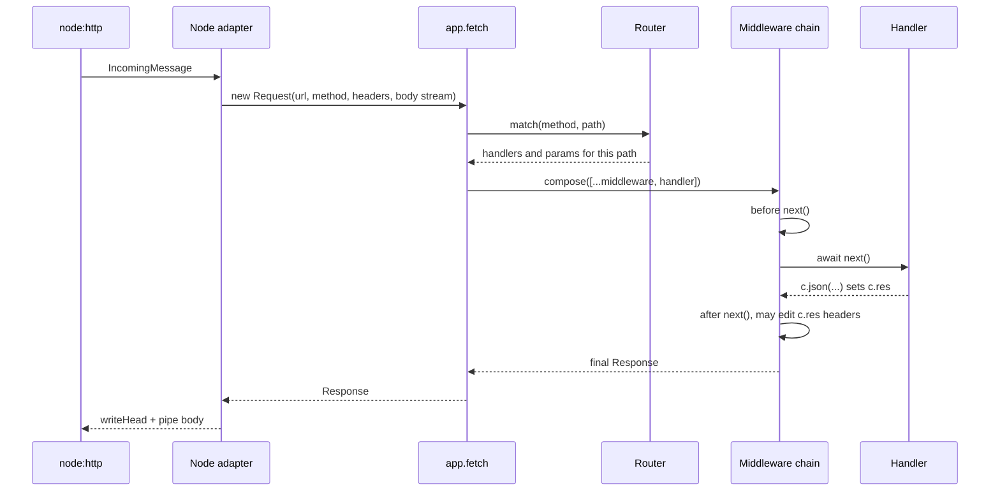

Step by step:

1. **Adapter.** On Node, `@hono/node-server` converts the `IncomingMessage` into a Web `Request`. Version 2 does this lazily: headers and the body stream are only materialised when your code reads them. On Bun, Deno and Workers the runtime already provides a `Request`, so there is no conversion.
2. **Routing.** `app.fetch` asks the router for everything registered for this method and path: middleware from `app.use()` and handlers from `app.get()` and friends, in registration order, plus the extracted parameters.
3. **Composition.** Hono's `compose()` turns that list into one async function. Each entry receives `(c, next)`. Calling `await next()` runs the rest of the chain and resumes afterwards, which is the onion model: code before `next()` runs top-down, code after it runs bottom-up.
4. **Handler.** The first handler that returns a `Response` finalises the context. Later handlers in the list are not called.
5. **Unwinding.** Middleware that awaited `next()` now sees `c.res` and may change headers (as `secureHeaders` does) or replace it.
6. **Errors and fallbacks.** A throw anywhere in the chain jumps to `app.onError`. If the chain finishes without a response, `app.notFound` produces one.

Because an app is just a `fetch` function, you can drive it without any server:

```ts
import { createApp } from './src/app.js';

const app = createApp();
const res = await app.fetch(new Request('http://localhost/health'));
console.log(res.status, await res.json()); // 200 { status: 'ok', uptimeSeconds: 0 }
```

### 1.5 The Context Object `c`

Every middleware and handler receives one `Context`, created per request and discarded afterwards. It wraps the request, collects the response, and carries per-request values.

| Member | Type | Purpose |
| --- | --- | --- |
| `c.req` | `HonoRequest` | Typed request wrapper: `param()`, `query()`, `queries()`, `header()`, `json()`, `parseBody()`, `valid()`, `url`, `path`, `method`. `c.req.raw` is the underlying `Request`. |
| `c.env` | `E['Bindings']` | Runtime bindings. On Workers: KV, D1, secrets. On Node: `{ incoming, outgoing }` from the adapter. In tests: the third argument of `app.request()`. |
| `c.var`, `c.get(key)`, `c.set(key, value)` | `E['Variables']` | Per-request storage shared by middleware and handlers. Typed by the app's generic or by the middleware that sets it. |
| `c.executionCtx` | `ExecutionContext` | On Workers and similar: `waitUntil(promise)` to run work after the response is sent. Throws on Node, where there is no execution context. |
| `c.text()`, `c.json()`, `c.html()`, `c.body()`, `c.redirect()` | Response builders | Create the `Response`, set `Content-Type`, and merge headers added earlier with `c.header()`. |
| `c.header(name, value, { append })` | Response headers | Set before or after the response is created. Middleware uses this after `next()`. |
| `c.status(code)` | Default status | Status used by the next builder call if it does not pass one. |
| `c.res` | `Response` | The response produced so far. Middleware can read or replace it after `next()`. |
| `c.error` | `Error \| undefined` | Set when a handler threw and `onError` handled it, so outer middleware can log it. |
| `c.notFound()` | `Response` | Delegates to the app's `notFound` handler from inside a handler. |

```ts
import { Hono } from 'hono';

type Env = { Variables: { startedAt: number } };

const app = new Hono<Env>()
  .use(async (c, next) => {
    c.set('startedAt', performance.now());
    await next();
    // Runs after the handler: c.res exists now.
    c.header('Server-Timing', `app;dur=${(performance.now() - c.var.startedAt).toFixed(1)}`);
  })
  .get('/hello/:name', (c) => {
    const name = c.req.param('name');
    const shout = c.req.query('shout') === '1';
    c.header('Cache-Control', 'no-store');
    return c.text(shout ? `HELLO ${name.toUpperCase()}` : `Hello ${name}`);
  });
```

`c.var` and `c.get()` read the same storage. `c.var.key` is shorter and keeps the type; `c.get('key')` is handy when the key is dynamic.

### 1.6 One App, Many Runtimes

The application module (`src/app.ts`) stays identical. Only a tiny entry file changes per runtime, and the repo ships all of them: [src/server.ts](src/server.ts), [src/bun.ts](src/bun.ts), [src/deno.ts](src/deno.ts) and [src/worker.ts](src/worker.ts).

```ts
// Node.js (this repo): src/server.ts
import { serve } from '@hono/node-server';
import { createApp } from './app.js';
serve({ fetch: createApp().fetch, port: 8080, hostname: '0.0.0.0' });
```

```ts
// Bun: src/bun.ts, run with `bun run src/bun.ts`
import { createApp } from './app.js';

export default {
  port: Number.parseInt(process.env.PORT ?? '', 10) || 8080,
  fetch: createApp({ apiKey: process.env.API_KEY || undefined, log: true }).fetch,
};
```

```ts
// Deno: src/deno.ts, run with `deno serve --port 8080 --unstable-sloppy-imports src/deno.ts`
// (sloppy imports let Deno resolve the './x.js' specifiers that NodeNext requires)
import { createApp } from './app.js';

export default createApp({ log: true });
```

```ts
// Cloudflare Workers: src/worker.ts, set as "main" in wrangler.jsonc
import { createApp } from './app.js';

export default createApp(); // Workers call app.fetch(request, env, ctx)
```

```ts
// AWS Lambda behind API Gateway or a Function URL
import { handle } from 'hono/aws-lambda'; // '@hono/aws-lambda' from v5
import { createApp } from './app.js';
export const handler = handle(createApp());
```

| Runtime | How the server starts | Where config comes from | Static files | Notes |
| --- | --- | --- | --- | --- |
| Node.js | `serve()` from `@hono/node-server` | `process.env` | `serveStatic` from `@hono/node-server/serve-static` | The only runtime that needs an adapter. Supports graceful shutdown through the returned `server`. |
| Bun | Bun reads the default export's `fetch` and `port` | `process.env` or `Bun.env` | `serveStatic` from `hono/bun` | Fastest local loop; `bun test` can run the same tests. |
| Deno | `deno serve` reads the default export, or `Deno.serve(app.fetch)` | `Deno.env` (needs `--allow-env`) | `serveStatic` from `hono/deno` | Import Hono from JSR (`jsr:@hono/hono`) or npm. |
| Cloudflare Workers | The platform calls `fetch(request, env, ctx)` | `c.env` bindings from `wrangler.jsonc` | Workers static assets | No `process.env` by default; per-request `env` only. |
| AWS Lambda | `handle(app)` converts API Gateway or Function URL events | Lambda environment variables | S3 plus CloudFront | Use `streamHandle` for response streaming. |

Two rules keep an app portable: read configuration through `c.env` or an options object passed to `createApp()` rather than `process.env` inside handlers, and use Web APIs (`crypto.randomUUID()`, `fetch`, `TextEncoder`) instead of Node built-ins. The starter's `/health` route uses `Date.now()`, recorded on the first request rather than at import time, instead of `process.uptime()` for exactly this reason.

`getRuntimeKey()` from `hono/adapter` tells you where you are running, and `env(c)` from the same module returns runtime-appropriate environment variables when you cannot avoid reading them in a handler:

```ts
import { Hono } from 'hono';
import { env, getRuntimeKey } from 'hono/adapter';

const app = new Hono().get('/whoami', (c) => {
  const { REGION } = env<{ REGION?: string }>(c);
  return c.json({ runtime: getRuntimeKey(), region: REGION ?? 'unknown' });
});
```

### 1.7 Testing Without a Server

`app.request(input, init?, env?)` builds a `Request` from a path or URL and calls `app.fetch`. No port is opened, so tests run in milliseconds and in parallel.

```ts
import { describe, expect, it } from 'vitest';
import { createApp } from '../src/app.js';

describe('app shell', () => {
  it('GET /health answers ok', async () => {
    const res = await createApp().request('/health');
    expect(res.status).toBe(200);
    expect(await res.json()).toMatchObject({ status: 'ok' });
  });

  it('keeps a caller-supplied request id', async () => {
    const res = await createApp().request('/health', { headers: { 'X-Request-Id': 'trace-123' } });
    expect(res.headers.get('X-Request-Id')).toBe('trace-123');
  });
});
```

That is [tests/app.test.ts](tests/app.test.ts). Three ways to exercise an app, and when each fits:

| Technique | What it tests | Speed | Use for |
| --- | --- | --- | --- |
| `app.request('/path', init, env)` | Routing, middleware, handlers | Fastest, no I/O | Most tests |
| `testClient(app)` from `hono/testing` | Same, through the typed RPC client | Fast | Checking that `AppType` matches reality (Stage 5) |
| Real server plus `fetch` | Adapter, sockets, headers on the wire | Slower | A few smoke tests; the CI Docker job does this with `curl` |

Compared with Express plus supertest, there is nothing to install and no server to start or close. The same tests run under Bun (`bun test`) and, with `@cloudflare/vitest-pool-workers`, inside the Workers runtime.

### 1.8 Composition Root and Project Layout

The starter builds its app in a factory instead of exporting a module-level singleton. The difference matters as soon as there is state or configuration.

| | Module singleton (`export const app = new Hono()`) | Factory (`export function createApp(options)`) |
| --- | --- | --- |
| Test isolation | All tests share one store; order-dependent failures | Fresh app per test |
| Configuration | Read from `process.env` at import time | Passed in by the entry file |
| Multiple runtimes | Import side effects can call Node APIs on Workers | Entry file decides what to pass |
| RPC typing | `typeof app` | `ReturnType<typeof createApp>` |

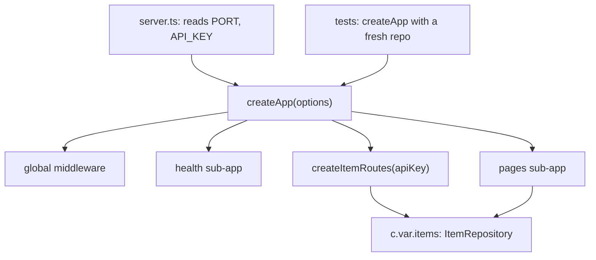

A layout that scales: one folder per feature under `src/routes/`, each exporting a sub-app or a factory; shared middleware in `src/middleware/`; schemas next to the routes that use them or in a shared `schemas.ts` when the client also imports them. Keep `app.ts` as the only file that knows every feature.

### 1.9 Pitfalls

| Pitfall | Symptom | Fix |
| --- | --- | --- |
| Binding to `localhost` in a container | `curl: (52) Empty reply from server` or `connection refused` from the host, while logs say the server is listening | Pass `hostname: '0.0.0.0'` to `serve()` |
| Running `npm run dev` (tsx watch) in production | Higher memory, restarts on file changes, TypeScript compiled at runtime | Build with `tsc` and run `node dist/server.js` |
| Using `process.env` inside a handler deployed to Workers | `ReferenceError: process is not defined` (without `nodejs_compat`) | Read `c.env` or use `env(c)` from `hono/adapter` |
| Calling `c.executionCtx.waitUntil()` on Node | `Error: This context has no ExecutionContext` | Guard with `try`/`catch` or run the work inline on Node |
| Omitting `.js` in relative imports with `"module": "NodeNext"` | `TS2835: Relative import paths need explicit file extensions` | Write `./app.js` even though the file is `app.ts` |
| Forgetting to `return` the response from a handler | `Error: Context is not finalized. Did you forget to return a Response object or await next()?` | Always `return c.json(...)` |
| Middleware that does not `await next()` | Handler never runs, or headers set after `next()` are missing | `await next()` exactly once |
| Module-level app shared by tests | Tests pass alone and fail together | Build the app per test with a factory |
| `Number(process.env.PORT)` when `PORT=` is set but empty | The server listens on a random port, because `Number('')` is `0` and port 0 means "any free port" | Parse explicitly and fall back: `Number.parseInt(v ?? '', 10) \|\| 8080` |

### 1.10 Best Practices

- **Keep runtime code in the entry file**: `app.ts` should run unchanged on any runtime, so only `server.ts` imports `@hono/node-server`.
- **Build the app in a factory**: it gives tests isolation and makes configuration explicit.
- **Test with `app.request()` first**: it covers routing, middleware and handlers without sockets; save real-server tests for the adapter.
- **Pin Node to an LTS that your adapter supports**: `@hono/node-server` 2.x needs Node 20+, and Hono 5 needs 22.12+, so declare `"engines"` in package.json.
- **Handle `SIGTERM`**: containers get about 10 s to stop; closing the server lets in-flight requests finish.
- **Chain route registrations**: `app.get().post()` keeps types for the RPC client; separate statements lose them.
- **Prefer Web APIs over Node built-ins**: `crypto.randomUUID()` and `fetch` work everywhere, `node:crypto` does not.

### 1.11 Hands-on Exercise

Add a `GET /version` route that returns the service name, version and the runtime it is running on, without importing anything Node-specific.

Expected output on Node:

```bash
curl -s localhost:8080/version
# {"name":"learn-hono","version":"1.0.0","runtime":"node"}
```

Run the same module with `bun` or `deno` and `runtime` should change to `bun` or `deno`. The solution is in [solutions/stage1-version.ts](solutions/stage1-version.ts) and its test in [tests/solutions.test.ts](tests/solutions.test.ts). Mount it in `createApp()` with `.route('/version', version)` to try it live.

[Back to top ⤴️](#-table-of-contents)

---

## 2. Stage 2: Routing, Handlers & Responses

This stage covers how Hono maps a method and path to handlers, how to read every part of a request, how to group routes into sub-apps, and every way to build a response, including server-rendered JSX and streams. It assumes Stage 1. Afterwards you can design the URL space of a real API, render HTML pages next to JSON endpoints, and predict which handler answers any request.

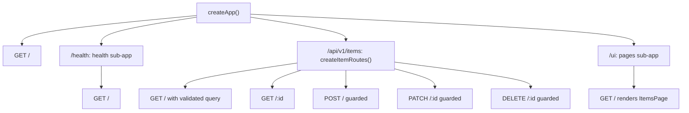

Every rule in this stage is pinned by a test in [tests/routing.test.ts](tests/routing.test.ts), so you can change a line and watch what breaks.

### 2.1 Defining Routes and HTTP Methods

A route is a method, a path pattern and one or more handlers. The last handler produces the response; any before it act as route-level middleware.

```ts
import { Hono } from 'hono';

const app = new Hono()
  .get('/books', (c) => c.json([]))
  .post('/books', async (c) => c.json(await c.req.json(), 201))
  .put('/books/:id', (c) => c.text(`replace ${c.req.param('id')}`))
  .patch('/books/:id', (c) => c.text(`update ${c.req.param('id')}`))
  .delete('/books/:id', (c) => c.body(null, 204))
  .options('/books', (c) => c.body(null, 204, { Allow: 'GET, POST, OPTIONS' }))
  .on(['PUT', 'PATCH'], '/profile', (c) => c.text(c.req.method))
  .all('/legacy/*', (c) => c.text('gone', 410));
```

| Method | Matches | Notes |
| --- | --- | --- |
| `app.get(path, ...h)` | `GET` and `HEAD` | Hono answers `HEAD` with the `GET` handler and drops the body. There is no `app.head()` since v4. |
| `app.post/put/patch/delete/options(path, ...h)` | That method | |
| `app.query(path, ...h)` | `QUERY` | New in 4.13: a safe, idempotent method with a body. |
| `app.on(method \| method[], path \| path[], ...h)` | Listed methods and paths | Also accepts custom methods such as `'PURGE'`. |
| `app.all(path, ...h)` | Any method | Useful for proxies and catch-alls; it hides 405 detection. |
| `app.use(path?, ...mw)` | Any method | Middleware only. Without a path it applies to `*`. |

**Chain or not?** Each registration method returns the app with an extended type. If you write `app.get(...)` as separate statements, the runtime behaviour is identical, but `typeof app` only knows the routes from the declaration line, so the RPC client in Stage 5 sees nothing. The starter returns the chained expression for that reason.

### 2.2 Path Parameters, Regex Constraints, Optional Segments and Wildcards

| Pattern | Matches | Does not match | `c.req.param()` |
| --- | --- | --- | --- |
| `/users/:id` | `/users/42`, `/users/café` (decoded) | `/users`, `/users/42/posts` | `{ id: '42' }` |
| `/posts/:id{[0-9]+}` | `/posts/7` | `/posts/hello` (falls through to the next route) | `{ id: '7' }` |
| `/archive/:year/:month?` | `/archive/2026`, `/archive/2026/11` | `/archive` | `{ year: '2026' }` or `{ year: '2026', month: '11' }` |
| `/files/*` | `/files`, `/files/`, `/files/a/b/c.txt` | `/filesystem` | none; use `c.req.path` |
| `/:file{.+\\.png}` | `/logo.png`, `/img/a.png` | `/logo.jpg` | `{ file: 'img/a.png' }` |
| `/wild/*/card` | `/wild/x/card` | `/wild//card` | none |

```ts
import { Hono } from 'hono';
import { routePath } from 'hono/route';

const app = new Hono()
  .get('/users/:id', (c) => c.json({ id: c.req.param('id') }))
  .get('/posts/:id{[0-9]+}', (c) => c.text(`post ${c.req.param('id')}`))
  .get('/posts/:slug', (c) => c.text(`slug ${c.req.param('slug')}`))
  .get('/files/*', (c) => c.text(`file route ${routePath(c)}`))
  .get('/archive/:year/:month?', (c) => c.json(c.req.param()));
```

Line by line:

| Line / API | Role | What happens at runtime |
| :--- | :--- | :--- |
| `c.req.param('id')` | One parameter | Returns the decoded string. The type is `string` because Hono infers the parameter name from the path literal. |
| `:id{[0-9]+}` | Constraint | The regex in braces must match the whole segment. A non-matching request is not a 404 yet; routing continues with later routes, so `/posts/hello` reaches the `:slug` route. |
| `routePath(c)` | Registered pattern | Returns `'/files/*'`, the pattern rather than the concrete path. Use it for metrics labels so that `/users/1` and `/users/2` share one series. |
| `c.req.param()` | All parameters | Returns an object. Optional parameters that are absent are omitted, not set to `undefined`. |

Parameters are always strings. Convert and validate them with a validator on the `param` target (Stage 3) rather than with `Number()` inside the handler.

### 2.3 Reading the Request: Query, Headers and Body

| Need | API | Returns | Notes |
| --- | --- | --- | --- |
| One query value | `c.req.query('q')` | `string \| undefined` | First value if the key repeats. |
| All query values | `c.req.query()` | `Record<string, string>` | Typed `string \| undefined` values in v5. |
| Repeated key | `c.req.queries('tag')` | `string[] \| undefined` | `?tag=a&tag=b` gives `['a', 'b']`. |
| One header | `c.req.header('X-Tenant')` | `string \| undefined` | Case-insensitive. |
| All headers | `c.req.header()` | `Record<string, string>` | Keys are lower-cased. |
| JSON body | `await c.req.json<T>()` | `T` (unchecked) | Throws on malformed JSON. Validate instead of trusting `T`. |
| Text body | `await c.req.text()` | `string` | |
| Form or multipart | `await c.req.parseBody()` | `Record<string, string \| File>` | `{ all: true }` collects repeated fields into arrays; `{ dot: true }` turns `a.b` into nested objects. |
| Binary | `await c.req.arrayBuffer()` / `c.req.blob()` | `ArrayBuffer` / `Blob` | |
| Stream | `c.req.raw.body` | `ReadableStream \| null` | For uploads you do not want to buffer. |
| URL pieces | `c.req.url`, `c.req.path`, `c.req.method` | `string` | `path` excludes the query string. |

```ts
import { Hono } from 'hono';

const app = new Hono()
  .get('/search', (c) =>
    c.json({ q: c.req.query('q') ?? null, tags: c.req.queries('tag') ?? [] }),
  )
  .post('/upload', async (c) => {
    const body = await c.req.parseBody();
    const file = body['file'];
    if (!(file instanceof File)) return c.json({ error: 'file is required' }, 400);
    return c.json({ name: file.name, bytes: file.size, type: file.type }, 201);
  });

// GET /search?q=hono&tag=edge&tag=rpc -> {"q":"hono","tags":["edge","rpc"]}
```

**Body caching.** A `Request` body is a stream and can be read once. `HonoRequest` caches the parsed result per format, so a validator and the handler can both call `c.req.json()` without a `TypeError: Body already used`. The cache does not cover `c.req.raw`: if any middleware consumes `c.req.raw.body` directly, later reads fail. [tests/context.test.ts](tests/context.test.ts) shows the cached double read.

### 2.4 Route Order and Precedence

Hono does not rank routes by specificity. It collects every route whose pattern matches, in registration order, and runs them as a chain. Middleware calls `next()`; the first handler that returns a response stops the chain.

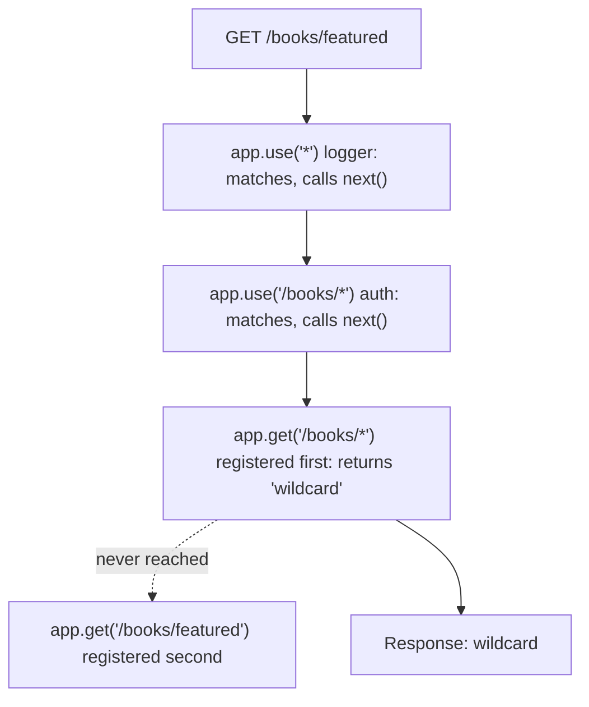

```ts
const app = new Hono();
app.get('/books/*', (c) => c.text('wildcard'));
app.get('/books/featured', (c) => c.text('specific, but registered second'));
// GET /books/featured -> "wildcard"
```

Rules that follow from this:

- Register specific routes before general ones. `/books/featured` must come before `/books/:id` and `/books/*`.
- Register `app.use()` middleware before the routes it should wrap. Middleware registered after a handler that already returned does not run for that request.
- A handler can defer to the next match by calling `await next()` instead of returning, which is how you build "try this, otherwise fall through" routes.
- `notFound` only runs when the chain ends without a response.

The middleware order is the onion from Stage 1. This test from the repo records it:

```ts
// order: ['global in', 'api in', 'handler', 'api out', 'global out']
```

### 2.5 Grouping: `route()`, `basePath()` and Sub-Apps

A sub-app is an ordinary `Hono` instance. `parent.route(prefix, child)` copies the child's routes and middleware under the prefix. `basePath(prefix)` returns a new app whose registrations are all prefixed.

```ts
import { Hono } from 'hono';

const books = new Hono()
  .get('/', (c) => c.text('all books'))
  .get('/:id', (c) => c.text(`book ${c.req.param('id')}`));

const api = new Hono().basePath('/api/v2').route('/books', books);

// GET /api/v2/books   -> "all books"
// GET /api/v2/books/9 -> "book 9"
// GET /books          -> 404
```

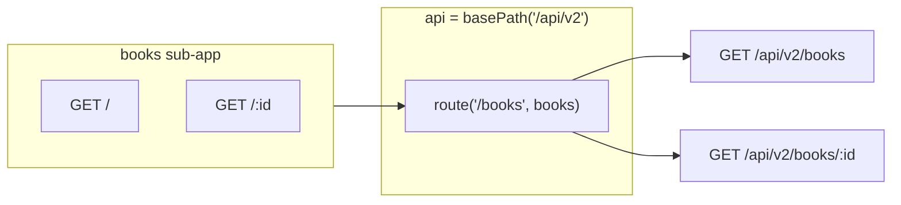

| Technique | Use it when | Watch out for |
| --- | --- | --- |
| `app.route('/prefix', subApp)` | Splitting features into files | Mount after defining the sub-app's routes; routes added to the child later are not copied. |
| Factory returning a sub-app (`createItemRoutes(opts)`) | The feature needs configuration or dependencies | Call it once at startup, not per request. |
| `new Hono().basePath('/api/v2')` | Versioning a whole API | `basePath` returns a new instance; keep using the returned value. |
| `app.use('/admin/*', mw)` | Middleware for one area | The pattern needs `/*` to cover sub-paths; `/admin` alone matches only that path. |

Compared with Express's `Router`, there is no separate router type: any app can be mounted into any other, and the mounted app can still be tested on its own with `books.request('/9')`.

### 2.6 Building Responses

| Builder | Content-Type set | Example |
| --- | --- | --- |
| `c.text(str, status?, headers?)` | `text/plain; charset=UTF-8` | `c.text('ok')` |
| `c.json(value, status?, headers?)` | `application/json` | `c.json({ ok: true }, 201, { 'Cache-Control': 'no-store' })` |
| `c.html(str \| jsx, status?)` | `text/html; charset=UTF-8` | `c.html(<Page />)` |
| `c.body(data, status?, headers?)` | None unless you set it | `c.body(null, 204)`, `c.body(stream)` |
| `c.redirect(location, status?)` | None | `c.redirect('/new', 301)`; default 302 |
| `c.notFound()` | From your `notFound` handler | Inside a handler, delegate to the app's 404 |
| `new Response(...)` | Whatever you set | Return any standard `Response`; Hono passes it through |

```ts
import { Hono } from 'hono';
import { deleteCookie, getCookie, setCookie } from 'hono/cookie';

const app = new Hono()
  .get('/created', (c) => c.json({ ok: true }, 201, { 'Cache-Control': 'no-store' }))
  .get('/old', (c) => c.redirect('/new', 301))
  .get('/raw', () => new Response('from a plain Response', { status: 202 }))
  .post('/login', (c) => {
    setCookie(c, 'session', 'opaque-id', { httpOnly: true, secure: true, sameSite: 'Lax', path: '/', maxAge: 3600 });
    return c.body(null, 204);
  })
  .get('/me', (c) => c.json({ session: getCookie(c, 'session') ?? null }))
  .post('/logout', (c) => {
    deleteCookie(c, 'session', { path: '/' });
    return c.body(null, 204);
  });
```

Status codes are typed. `c.json(data, 422)` makes `422` part of the route's type, which lets the RPC client narrow `res.status` to pick the right body type, as [tests/client.test.ts](tests/client.test.ts) does. Passing a number variable typed as `number` loses that; use `ContentfulStatusCode` from `hono/utils/http-status` when you must compute the status.

`c.json(value)` uses `JSON.stringify`, so `Date` becomes an ISO string, `Map` becomes `{}`, `BigInt` throws, and `undefined` properties disappear. The RPC client's inferred types reflect the JSON form (a `Date` field is typed `string` on the client).

### 2.7 Server-Rendered HTML with `hono/jsx`

Hono includes a JSX runtime that renders to strings on the server. Enable it in `tsconfig.json`:

```json
{
  "compilerOptions": {
    "jsx": "react-jsx",
    "jsxImportSource": "hono/jsx"
  }
}
```

The starter's view ([src/views/items-page.tsx](src/views/items-page.tsx)) and route ([src/routes/pages.tsx](src/routes/pages.tsx)):

```tsx
import type { Item } from '../types.js';
import { Layout } from './layout.js';

export function ItemsPage({ items }: { items: Item[] }) {
  return (
    <Layout title={`Items (${items.length})`}>
      <h1>Items</h1>
      {items.length === 0 ? (
        <p>No items yet.</p>
      ) : (
        <ul>
          {items.map((item) => (
            <li id={`item-${item.id}`}>
              <strong>{item.title}</strong>
              {item.description && <p>{item.description}</p>}
            </li>
          ))}
        </ul>
      )}
    </Layout>
  );
}
```

```tsx
import { Hono } from 'hono';
import type { AppEnv } from '../env.js';
import { ItemsPage } from '../views/items-page.js';

export const pages = new Hono<AppEnv>().get('/', (c) =>
  c.html(<ItemsPage items={c.var.items.list({ limit: 100 })} />),
);
```

| Line / API | Role | What happens at runtime |
| :--- | :--- | :--- |
| `jsxImportSource: 'hono/jsx'` | Compiler setting | TypeScript compiles `<li>` to calls into `hono/jsx/jsx-runtime`, not React. |
| `{item.title}` | Text child | Escaped: `<script>` becomes `&lt;script&gt;`. The repo's test posts a script tag as a title and asserts it is escaped. |
| `raw('<!DOCTYPE html>')` in the layout | Trusted HTML | `raw()` from `hono/html` skips escaping. JSX has no doctype syntax, so the layout emits it this way. Never pass user input to `raw()`. |
| `c.html(<ItemsPage />)` | Response | Renders the tree to a string (or a stream if components are async) with `text/html; charset=UTF-8`. |
| No `key` on list items | Server-only | Keys only matter for client-side diffing; server rendering ignores them. |

Alternatives inside Hono:

| Option | Good for | Trade-off |
| --- | --- | --- |
| `hono/jsx` components | Typed, composable pages | Needs the tsconfig change and `.tsx` files |
| `html` tagged template from `hono/html` | A few small fragments | No component props type-checking |
| `jsxRenderer()` middleware plus `c.render()` | A shared layout for many routes | One more middleware to understand |
| `hono/jsx/dom` client components | Interactive islands | Needs a client bundle build (Vite) |

Async components and `<Suspense>` streaming are covered in Masterclass M3.

### 2.8 Streaming Responses

`hono/streaming` builds a response whose body is written while the handler runs. The client starts receiving bytes before the work finishes.

```ts
import { Hono } from 'hono';
import { streamSSE, streamText } from 'hono/streaming';

const app = new Hono()
  .get('/stream', (c) =>
    streamText(c, async (stream) => {
      for (const word of ['one', 'two', 'three']) await stream.writeln(word);
    }),
  )
  .get('/ticks', (c) =>
    streamSSE(c, async (stream) => {
      let id = 0;
      while (id < 5) {
        await stream.writeSSE({ id: String(id), event: 'tick', data: JSON.stringify({ at: Date.now() }) });
        id += 1;
        await stream.sleep(1000);
      }
    }),
  );
```

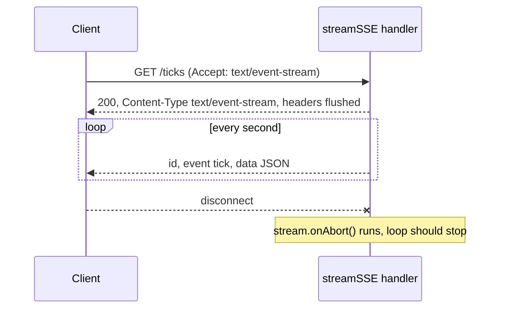

| Helper | Writes | Use for |
| --- | --- | --- |
| `stream(c, cb)` | Bytes (`stream.write(Uint8Array \| string)`, `stream.pipe(readable)`) | Proxying files or upstream bodies |
| `streamText(c, cb)` | Text, with `Content-Type: text/plain` and `Transfer-Encoding: chunked` | Token-by-token output, logs |
| `streamSSE(c, cb, onError?)` | Server-Sent Events frames | Live updates to browsers through `EventSource` |

Check `stream.aborted` or register `stream.onAbort()` so the loop stops when the client goes away. Reverse proxies that buffer (some nginx and CDN defaults) defeat streaming; send `X-Accel-Buffering: no` for nginx, and on AWS Lambda use `streamHandle` instead of `handle`.

### 2.9 Which Router Runs Your Routes

Hono ships five routers behind one interface. You rarely choose one, but knowing them explains behaviour such as fallbacks and startup cost.

| Router | Strategy | Strength | Limitation |
| --- | --- | --- | --- |
| RegExpRouter | Compiles all routes into one regular expression with capture groups | One regex test per request, very fast matching | Some patterns cannot be combined, for example two different regex constraints in the same parameter slot |
| TrieRouter | Tree of path segments | Supports every pattern | Slightly slower lookup |
| SmartRouter (default) | Tries its routers in order on the first match and keeps the first that accepts all routes | Picks RegExpRouter when possible, TrieRouter otherwise | Choice is fixed after the first request |
| LinearRouter | Checks routes one by one, no preprocessing | Fastest registration, good for cold starts where each instance serves few requests | Lookup cost grows with route count |
| PatternRouter | One small regex per route, tested in order | Smallest code, used by `hono/tiny` | Lookup cost grows with route count |

```ts
import { Hono } from 'hono';
import { getRouterName } from 'hono/dev';
import { Hono as QuickHono } from 'hono/quick'; // SmartRouter of LinearRouter + TrieRouter

const standard = new Hono().get('/a/:id', (c) => c.text('ok'));
await standard.request('/a/1');
console.log(getRouterName(standard)); // "SmartRouter + RegExpRouter"

const mixed = new Hono()
  .get('/:lang{[a-z]+}/docs', (c) => c.text('docs'))
  .get('/:lang{[0-9]+}/code', (c) => c.text('code'));
await mixed.request('/en/docs');
console.log(getRouterName(mixed)); // "SmartRouter + TrieRouter"

const quick = new QuickHono().get('/a/:id', (c) => c.text('ok'));
await quick.request('/a/1');
console.log(getRouterName(quick)); // "SmartRouter + LinearRouter"
```

Masterclass M1 takes RegExpRouter apart.

### 2.10 Pitfalls

| Pitfall | Symptom | Fix |
| --- | --- | --- |
| General route registered before a specific one | `GET /books/featured` returns the `/books/:id` handler with `id: 'featured'` | Register specific routes first |
| `app.use('/admin', mw)` | Middleware runs for `/admin` but not `/admin/users` | Use `/admin/*` |
| Routes registered as separate statements | `hc<AppType>()` client has no properties; `Property 'api' does not exist on type` | Chain registrations and export the type of the chained value |
| Reading `c.req.raw.body` in middleware, then `c.req.json()` in the handler | `TypeError: Body is unusable` or `Body already used` | Read through `c.req.json()`/`c.req.text()` so the cache is used, or clone with `c.req.raw.clone()` |
| Expecting numbers from `c.req.param()` or `c.req.query()` | `'10' > '9'` is false; arithmetic yields string concatenation | Coerce in a validator schema (`z.coerce.number()`) |
| `c.json(data, status)` with `status: number` | `Argument of type 'number' is not assignable to parameter of type 'ContentfulStatusCode'` | Use a literal or type the variable as `ContentfulStatusCode` |
| Passing user input to `raw()` or `dangerouslySetInnerHTML` | Stored XSS | Render user data as JSX children, which are escaped |
| Streaming behind a buffering proxy | Client receives everything at the end | Disable proxy buffering; on Lambda use `streamHandle` |
| Expecting 405 for a wrong method | Hono returns 404 by default | Add `methodNotAllowed({ app })` (4.13+) |
| Two regex constraints in one parameter slot | Works, but `getRouterName(app)` shows TrieRouter, and first-request latency rises slightly | Accept it, or restructure paths to share one constraint |

### 2.11 Best Practices

- **Version the API with `basePath('/api/v1')`**: it makes breaking changes a new mount, not a rewrite.
- **One sub-app per resource**: each file can be tested with its own `request()` and read without the rest of the app.
- **Chain registrations in every sub-app**: the RPC type of the parent includes children only if each child kept its type.
- **Return `204` with `c.body(null, 204)` for deletes**: an empty JSON object is not "no content", and `c.json(undefined)` throws in v5.
- **Set `Location` on `201 Created`**: clients and tools follow it to the new resource.
- **Use `routePath(c)` for metrics and logs**: concrete paths explode metric cardinality.
- **Prefer JSX children over `raw()`**: escaping is the default and should stay that way.
- **Add `methodNotAllowed` on public APIs**: clients get a correct 405 and an `Allow` header.

### 2.12 Hands-on Exercise

Build a short-link router: `GET /:code` where the code is exactly six lowercase letters or digits. A known code redirects with `302` and `Cache-Control: private, max-age=60`; a well-formed unknown code returns a JSON `404`; anything else returns a JSON `400`. Do it with two routes and no `if` on the code's format.

Expected:

```bash
curl -si localhost:8080/r/hono01 | head -3
# HTTP/1.1 302 Found
# location: https://hono.dev
# cache-control: private, max-age=60
curl -s localhost:8080/r/Not-A-Code
# {"error":{"code":"BAD_CODE","message":"Codes are 6 lowercase letters or digits"}}
```

The solution is [solutions/stage2-links.ts](solutions/stage2-links.ts); the regex-constrained route falls through to the unconstrained one, exactly as in section 2.2. Tests are in [tests/solutions.test.ts](tests/solutions.test.ts).

[Back to top ⤴️](#-table-of-contents)

---

## 3. Stage 3: Validation, Typed Context & the Data Layer

This stage makes the API trustworthy: every input is parsed before a handler runs, errors leave in one shape, per-request values are typed, and storage sits behind an interface. It builds on the routes from Stage 2. Afterwards you can add a resource with validated input, typed dependencies and a real database without the handlers knowing which database it is.

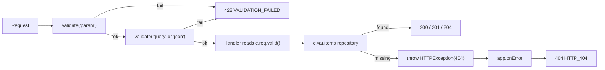

The code is in [src/schemas.ts](src/schemas.ts), [src/middleware/validate.ts](src/middleware/validate.ts), [src/routes/items.ts](src/routes/items.ts) and [src/repository.ts](src/repository.ts); [tests/context.test.ts](tests/context.test.ts) pins every behaviour this stage describes.

### 3.1 The Validator Middleware Model

A validator in Hono is route middleware with a target and a function. It reads one part of the request, either returns a value or returns a `Response`, and stores the value so the handler can read it with `c.req.valid(target)`. The type of that value flows into the handler and into the RPC client.

| Target | Source | Notes |
| --- | --- | --- |
| `json` | `await c.req.json()` | Only when `Content-Type` is JSON. Otherwise the validator sees `{}`, so a required field fails. |
| `form` | `await c.req.parseBody()` | `multipart/form-data` or `application/x-www-form-urlencoded`. Values are `string` or `File`. |
| `query` | `c.req.queries()` | Values are strings (or string arrays). Coerce numbers and booleans. |
| `param` | `c.req.param()` | Path parameters, strings. |
| `header` | `c.req.header()` | Keys are lower-case: write `'x-tenant'`, not `'X-Tenant'`, in the schema. |
| `cookie` | `getCookie(c)` | Parsed cookie map. |

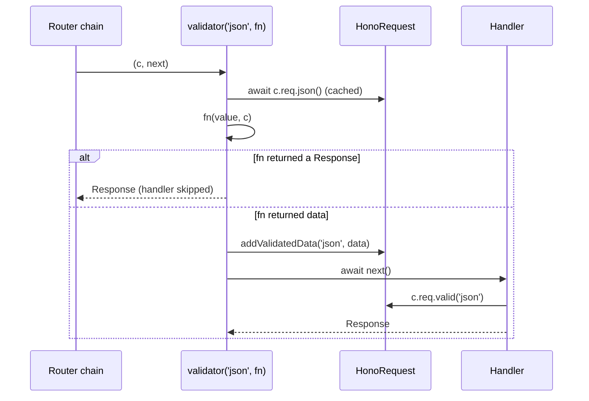

Several validators can sit on one route, one per target. They run left to right, and the first failure stops the chain.

### 3.2 `hono/validator` Without a Schema Library

The built-in validator takes a plain function. It is useful for tiny checks, transformations, and to see the mechanism without a library in the way.

```ts
import { Hono } from 'hono';
import { validator } from 'hono/validator';

const app = new Hono().post(
  '/signup',
  validator('form', (value, c) => {
    const email = value['email'];
    if (typeof email !== 'string' || !email.includes('@')) {
      return c.json({ error: 'email is required' }, 400);
    }
    return { email: email.toLowerCase() };
  }),
  (c) => c.json({ welcome: c.req.valid('form').email }, 201),
);
```

| Line / API | Role | What happens at runtime |
| :--- | :--- | :--- |
| `validator('form', fn)` | Middleware factory | Parses the form body once, then calls `fn(value, c)`. |
| `value['email']` | Raw input | Typed `string \| File \| (string \| File)[]`, so the `typeof` check is required, not decorative. |
| `return c.json(..., 400)` | Reject | Returning a `Response` ends the request; the handler never runs. |
| `return { email }` | Accept and transform | Whatever is returned becomes `c.req.valid('form')`, with its type inferred. |

Hand-written validators do not scale past a few fields: no error aggregation, no shared types with the client, no reuse. That is what schema libraries are for.

### 3.3 Zod 4 with `@hono/zod-validator`

The starter declares its rules once in [src/schemas.ts](src/schemas.ts):

```ts
import { z } from 'zod';

export const itemStatusSchema = z.enum(['pending', 'in_progress', 'completed']);

const fields = {
  title: z.string().trim().min(2).max(100),
  description: z.string().trim().max(500),
  status: itemStatusSchema,
};

export const createItemSchema = z.object({
  title: fields.title,
  description: fields.description.default(''),
  status: fields.status.default('pending'),
});

// No defaults here: a default inside a PATCH schema would overwrite stored values.
export const updateItemSchema = z
  .object(fields)
  .partial()
  .refine((patch) => Object.keys(patch).length > 0, {
    message: 'Send at least one of: title, description, status',
  });

// Query strings are always strings, so numbers must be coerced.
export const listQuerySchema = z.object({
  status: itemStatusSchema.optional(),
  limit: z.coerce.number().int().min(1).max(100).default(20),
});
```

| Line / API | Role | What happens at runtime |
| :--- | :--- | :--- |
| `z.string().trim().min(2)` | Normalise then check | Trims first, so `'  a '` fails `min(2)` and `'  Write tests  '` is stored as `'Write tests'`. |
| `.default('')` on create only | Defaults | Missing `description` becomes `''`. Defaults belong to creation, not to updates. |
| `z.object(fields).partial()` | PATCH shape | Every field optional, no defaults, so `{ title }` changes only the title. A test asserts `status` survives a PATCH. |
| `.refine(...)` | Cross-field rule | Rejects `{}` with a readable message instead of performing a no-op write. |
| `z.coerce.number()` | Query coercion | Turns `'2'` into `2`; `'abc'` becomes `NaN` and fails `.int()`. |
| `z.infer<typeof createItemSchema>` | Types | [src/types.ts](src/types.ts) derives `CreateItemInput` from the schema, so types and runtime checks cannot drift. |

`zValidator(target, schema, hook?)` wires a schema into Hono. Without a hook a failure returns `400` with Zod's error object, which leaks library details into your API contract. The starter wraps it once so every route answers the same way:

```ts
import { zValidator } from '@hono/zod-validator';
import type { ValidationTargets } from 'hono';
import type { ZodType } from 'zod';

export const validate = <Target extends keyof ValidationTargets, Schema extends ZodType>(
  target: Target,
  schema: Schema,
) =>
  zValidator(target, schema, (result, c) => {
    if (!result.success) {
      return c.json(
        {
          error: {
            code: 'VALIDATION_FAILED',
            message: `Invalid ${target}`,
            issues: result.error.issues.map((issue) => ({
              path: issue.path.map(String).join('.'),
              message: issue.message,
            })),
          },
        },
        422,
      );
    }
  });
```

A failed `POST /api/v1/items` with `{"title":"x","status":"later"}` returns:

```json
{
  "error": {
    "code": "VALIDATION_FAILED",
    "message": "Invalid json",
    "issues": [
      { "path": "title", "message": "Too small: expected string to have >=2 characters" },
      { "path": "status", "message": "Invalid option: expected one of \"pending\"|\"in_progress\"|\"completed\"" }
    ]
  }
}
```

Using it on several targets at once:

```ts
import { Hono } from 'hono';
import { z } from 'zod';
import { validate } from './middleware/validate.js';

const app = new Hono().put(
  '/teams/:teamId/members',
  validate('param', z.object({ teamId: z.uuid() })),
  validate('header', z.object({ 'x-tenant': z.string().min(1) })),
  validate('json', z.object({ userId: z.string(), role: z.enum(['owner', 'member']) })),
  (c) => {
    const { teamId } = c.req.valid('param');
    const tenant = c.req.valid('header')['x-tenant'];
    return c.json({ teamId, tenant, ...c.req.valid('json') });
  },
);
```

`z.uuid()` is Zod 4's top-level string format (Zod 3 wrote `z.string().uuid()`, which still works but is deprecated). Other Zod 3 to 4 changes that affect Hono code: error messages are worded differently, `.default()` now short-circuits on `undefined` and must match the output type, and `z.record()` requires both key and value schemas.

#### Other schema libraries

`@hono/standard-validator` accepts any library that implements the Standard Schema interface, so the route code does not change when you switch.

```ts
import { sValidator } from '@hono/standard-validator';
import { Hono } from 'hono';
import * as v from 'valibot';

const Signup = v.object({ email: v.pipe(v.string(), v.email()), age: v.optional(v.number()) });

const app = new Hono().post('/signup', sValidator('json', Signup), (c) => {
  const { email } = c.req.valid('json');
  return c.json({ email }, 201);
});
```

| Library | Adapter | Bundle impact | Strengths |
| --- | --- | --- | --- |
| Zod 4 | `@hono/zod-validator` | Medium; `zod/mini` is smaller | Largest ecosystem, `@hono/zod-openapi` (Stage 5) |
| Valibot | `@hono/valibot-validator` or standard-validator | Small, tree-shakes per function | Good for Workers size limits |
| ArkType | `@hono/arktype-validator` or standard-validator | Medium | Type-syntax strings, fast checks |
| TypeBox | `@hono/typebox-validator` | Medium | Produces JSON Schema directly |
| `hono/validator` | Built in | None | Tiny checks, custom parsing |

### 3.4 Typing the Environment: Bindings and Variables

`new Hono<E>()` takes one type argument with two optional keys:

- `Bindings`: what the runtime passes as `env`. On Workers that is your KV namespaces, D1 databases, secrets and variables from `wrangler.jsonc`.
- `Variables`: values that middleware stores on the context with `c.set()` and handlers read with `c.var`.

```ts
// src/env.ts
import type { ItemRepository } from './types.js';

export type AppEnv = {
  Variables: {
    items: ItemRepository;
  };
};
```

Use `type`, not `interface`, for `AppEnv`; Hono merges it with its own inferred types and an `interface` declared in some shapes fails to merge cleanly.

Middleware can declare what it adds instead of putting everything in the app type. `createMiddleware` from `hono/factory` carries the type to the handlers that use it:

```ts
import { Hono } from 'hono';
import { createMiddleware } from 'hono/factory';
import { HTTPException } from 'hono/http-exception';

type User = { id: string; role: 'admin' | 'reader' };

const authenticate = createMiddleware<{ Variables: { user: User } }>(async (c, next) => {
  if (c.req.header('Authorization') !== 'Bearer admin-token') {
    throw new HTTPException(401, { message: 'Sign in first' });
  }
  c.set('user', { id: 'u-1', role: 'admin' });
  await next();
});

const app = new Hono().get('/me', authenticate, (c) => c.json(c.var.user)); // c.var.user: User
```

Bindings on Workers, and how a test supplies them:

```ts
import { Hono } from 'hono';

type Bindings = { GREETING: string };

const app = new Hono<{ Bindings: Bindings }>().get('/greet', (c) => c.text(`${c.env.GREETING}, world`));

// In a test: the third argument of app.request() becomes c.env
const res = await app.request('/greet', {}, { GREETING: 'Hello' });
console.log(await res.text()); // "Hello, world"
```

| Mechanism | Scope | Typed by | Use for |
| --- | --- | --- | --- |
| `c.env` | Per request, provided by the runtime | `Bindings` | Platform resources and secrets on Workers |
| `createApp(options)` | Per app instance | The options interface | Config on Node, injected by the entry file |
| `c.set()` / `c.var` | Per request | `Variables`, or the middleware's own generic | Repositories, the current user, request ids |
| `ContextVariableMap` augmentation | Global | `declare module 'hono' { interface ContextVariableMap { ... } }` | Library middleware (this is how `requestId()` types `c.var.requestId`) |

### 3.5 Error Handling: `HTTPException`, `onError` and `notFound`

Handlers throw for anything that is not the happy path. One `onError` turns exceptions into the API's error shape, so handler code stays linear.

```ts
// src/routes/items.ts
const notFound = (id: string) => new HTTPException(404, { message: `Item ${id} not found` });

// inside the router
.get('/:id', (c) => {
  const id = c.req.param('id');
  const item = c.var.items.get(id);
  if (!item) throw notFound(id);
  return c.json({ data: item }, 200);
})
```

```ts
// src/app.ts
app.onError((err, c) => {
  if (err instanceof HTTPException) {
    if (err.res) return err.getResponse();
    return c.json({ error: { code: `HTTP_${err.status}`, message: err.message } }, err.status);
  }
  console.error(`[${c.var.requestId}]`, err);
  return c.json({ error: { code: 'INTERNAL', message: 'Internal Server Error' } }, 500);
});
```

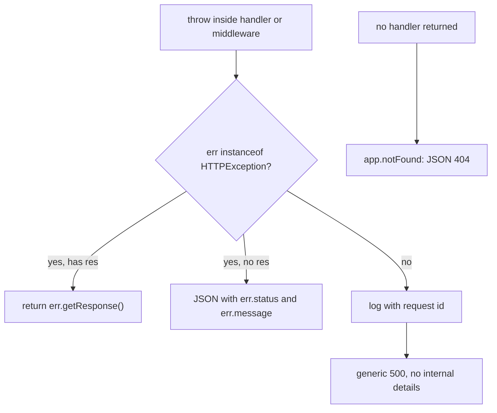

| `HTTPException` option | Effect |
| --- | --- |
| `message` | Text for logs and for the default response body. |
| `res` | A complete `Response` to send instead. The starter's `requireApiKey` uses it to add `WWW-Authenticate: Bearer`. |
| `cause` | The original error, for logs. Never serialise it to the client. |

Design notes:

- Keep one error envelope for the whole API (`{ error: { code, message, issues? } }` here). RFC 9457 `application/problem+json` is the standard alternative if your consumers expect it.
- Unknown errors never echo `err.message`; it can contain SQL, file paths or tokens.
- `app.onError` on the root app handles errors from mounted sub-apps too.
- In Hono 5 the signature becomes `onError((c) => ...)` with the error on `c.error` (see V.4).

### 3.6 The Repository Pattern and Dependency Injection Through Context

Handlers in the starter depend on an interface, not on a storage engine:

```ts
// src/types.ts
export interface ItemRepository {
  list(filter: ListFilter): Item[];
  get(id: string): Item | undefined;
  create(input: CreateItemInput): Item;
  update(id: string, patch: UpdateItemInput): Item | undefined;
  delete(id: string): boolean;
}
```

```ts
// src/repository.ts (excerpt)
export class InMemoryItemRepository implements ItemRepository {
  readonly #items = new Map<string, Item>();

  create(input: CreateItemInput): Item {
    const now = new Date().toISOString();
    const item: Item = { id: crypto.randomUUID(), ...input, createdAt: now, updatedAt: now };
    this.#items.set(item.id, item);
    return item;
  }
  // list, get, update, delete ...
}
```

`createApp()` puts the chosen implementation on every request with `c.set('items', items)`, and tests pass their own:

```ts
const app = createApp({ items: new InMemoryItemRepository() }); // empty store for this test
```

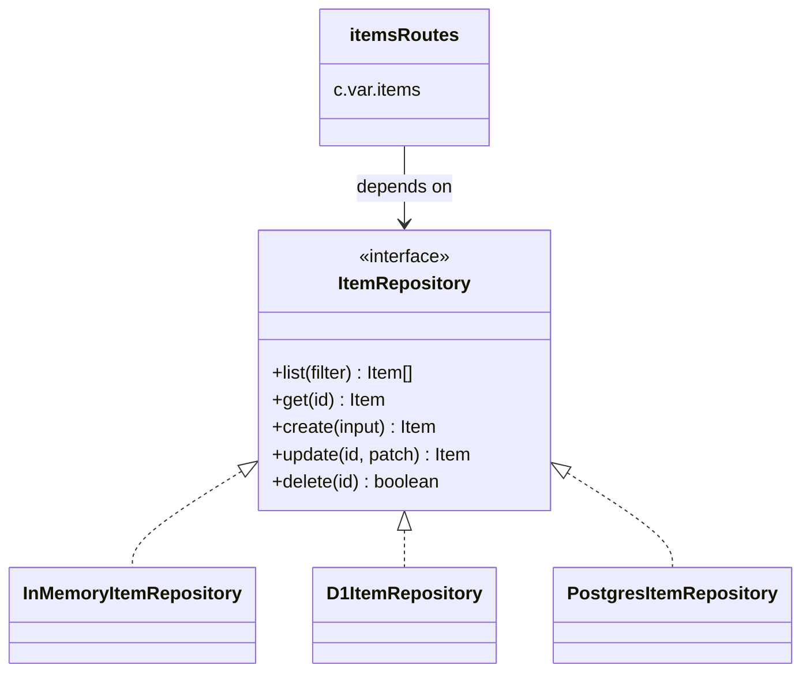

Why through the context and not a module import:

| | `import { db } from './db.js'` in handlers | `c.var.items` injected by middleware |
| --- | --- | --- |
| Swap storage in tests | Module mocking (`vi.mock`) | Pass a different object |
| Per-request resources (Workers bindings, a transaction, a tenant's database) | Impossible at import time | Middleware builds it from `c.env` per request |
| Coupling | Every handler knows the driver | Handlers know an interface |

An earlier version of this starter generated ids with `String(store.size + 1)`, which hands out a duplicate id after any delete. `crypto.randomUUID()` avoids that, and the test "ids stay unique after a delete" guards it.

### 3.7 Real Persistence: Drizzle on D1 or PostgreSQL

Real stores are asynchronous, so a production repository interface returns promises. The route code changes only by `await`.

```ts
// src/db/schema.ts
import { sqliteTable, text } from 'drizzle-orm/sqlite-core';

export const items = sqliteTable('items', {
  id: text('id').primaryKey(),
  title: text('title').notNull(),
  description: text('description').notNull().default(''),
  status: text('status', { enum: ['pending', 'in_progress', 'completed'] }).notNull().default('pending'),
  createdAt: text('created_at').notNull(),
  updatedAt: text('updated_at').notNull(),
});
```

```ts
// src/db/d1-repository.ts
import { eq } from 'drizzle-orm';
import { drizzle } from 'drizzle-orm/d1';
import { createMiddleware } from 'hono/factory';
import { items } from './schema.js';
import type { CreateItemInput } from '../types.js';

export function d1Items(db: D1Database) {
  const orm = drizzle(db);
  return {
    get: (id: string) => orm.select().from(items).where(eq(items.id, id)).get(),
    async create(input: CreateItemInput) {
      const now = new Date().toISOString();
      const [row] = await orm
        .insert(items)
        .values({ id: crypto.randomUUID(), ...input, createdAt: now, updatedAt: now })
        .returning();
      return row;
    },
  };
}

// Built per request, because the D1 binding only exists on c.env.
export const withD1Items = createMiddleware<{
  Bindings: { DB: D1Database };
  Variables: { items: ReturnType<typeof d1Items> };
}>(async (c, next) => {
  c.set('items', d1Items(c.env.DB));
  await next();
});
```

`D1Database` comes from `@cloudflare/workers-types` (or the types `wrangler types` generates). Masterclass M4 builds the complete edge data layer, including KV caching and Durable Objects.

| Runtime | Common store | Driver / ORM | Notes |
| --- | --- | --- | --- |
| Node.js | PostgreSQL | Drizzle (`drizzle-orm/node-postgres`), Kysely, Prisma | Create the pool once in `server.ts`, not per request. |
| Cloudflare Workers | D1 (SQLite), KV, Durable Objects, Hyperdrive to Postgres | Drizzle (`drizzle-orm/d1`), raw `env.DB.prepare()` | Bindings arrive per request through `c.env`. |
| Bun | SQLite (`bun:sqlite`), PostgreSQL (`Bun.sql`) | Drizzle (`drizzle-orm/bun-sqlite`) | Built-in drivers, no native addon. |
| Deno | Deno KV, PostgreSQL | `Deno.openKv()`, Drizzle | KV is available locally and on Deno Deploy. |

### 3.8 Migrations and Schema Evolution

Drizzle Kit generates SQL migration files from the schema; the platform tool applies them.

```ts
// drizzle.config.ts
import { defineConfig } from 'drizzle-kit';

export default defineConfig({
  dialect: 'sqlite',
  schema: './src/db/schema.ts',
  out: './drizzle',
});
```

```bash
npx drizzle-kit generate                                   # writes drizzle/0001_<name>.sql from schema changes
npx wrangler d1 migrations apply learn-hono-db --local     # apply to the local D1 used by wrangler dev
npx wrangler d1 migrations apply learn-hono-db --remote    # apply to production, before deploying code that needs it
npx drizzle-kit migrate                                    # PostgreSQL / Node: apply with Drizzle's own runner
```

For D1, point wrangler at the folder with `"migrations_dir": "drizzle"` in the `d1_databases` entry of `wrangler.jsonc`.

Deploys are not atomic across code and schema, and Workers run old and new versions side by side for a while. Use expand and contract:

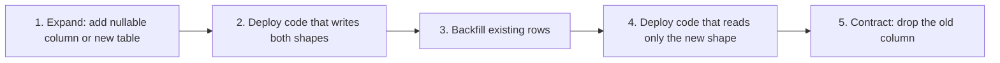

Never rename or drop a column in the same deploy as the code change that stops using it.

### 3.9 Request-Scoped State Without Passing `c` Around

Deep helpers (a logger, an audit function) sometimes need the current request. Passing `c` through every call is noisy. `contextStorage()` stores the context in `AsyncLocalStorage` for the duration of the request:

```ts
import { Hono } from 'hono';
import { contextStorage, getContext, tryGetContext } from 'hono/context-storage';
import { requestId } from 'hono/request-id';

function audit(action: string) {
  const c = getContext(); // throws outside a request
  console.log(JSON.stringify({ action, requestId: c.var.requestId, path: c.req.path }));
}

function maybeAudit(action: string) {
  const c = tryGetContext(); // undefined outside a request, for code shared with scripts
  if (c) console.log(action, c.var.requestId);
}

const app = new Hono()
  .use(contextStorage())
  .use(requestId())
  .delete('/items/:id', (c) => {
    audit('item.delete');
    return c.body(null, 204);
  });
```

`AsyncLocalStorage` is available on Node, Bun and Deno; on Cloudflare Workers enable the `nodejs_compat` compatibility flag. Prefer explicit parameters in domain code and reserve this for cross-cutting concerns such as logging and tracing.

### 3.10 Pitfalls

| Pitfall | Symptom | Fix |
| --- | --- | --- |
| JSON request without `Content-Type: application/json` | `422` with `Invalid input: expected string, received undefined` for every required field, although the body looks right | Send the header; clients such as `fetch` with a string body default to `text/plain` |
| `.default()` inside the PATCH schema | Updating only `title` silently resets `status` to `pending` | Separate create and update schemas; no defaults on updates |
| Numbers in query or params without coercion | `Invalid input: expected number, received string` | `z.coerce.number()` or a `transform` |
| Upper-case keys in a `header` schema | Header validation always fails | Use lower-case keys (`'x-tenant'`) |
| No hook on `zValidator` | Clients receive Zod's internal error format with `400` | Wrap once with a hook that maps issues to your envelope |
| Echoing `err.message` for unknown errors | Stack details or SQL leak in 500 responses | Generic message out, full error in logs with the request id |
| `interface` for the `Hono<E>` generic | Odd type errors when combining with middleware types | Declare `type AppEnv = { ... }` |
| Creating a DB pool inside middleware on Node | Connection count grows with traffic until the database refuses connections | Create pools once at startup; per-request only for Workers bindings |
| `getContext()` without `contextStorage()` | `Error: Context is not available` | Register `contextStorage()` first, or use `tryGetContext()` |
| Trusting `c.req.json<T>()` | Runtime crashes on malformed bodies despite the type | The type argument is a cast. Validate. |

### 3.11 Best Practices

- **Validate at the edge of every route**: handlers should only see `c.req.valid()` output, never raw input.
- **Derive types from schemas**: `z.infer` keeps runtime checks and TypeScript types in one place.
- **One error envelope**: clients write one error parser, and logs are searchable by `code`.
- **Return 422 for semantic validation errors and 400 for unparseable bodies**: it tells the client whether retrying with a fix can work.
- **Throw `HTTPException` from handlers and format centrally**: handlers stay linear, and the format changes in one place.
- **Depend on repository interfaces and inject through `c.set()`**: tests and runtimes swap implementations without mocking.
- **Expand, then contract, for schema changes**: old and new code overlap during every deploy.
- **Keep `contextStorage()` for cross-cutting concerns**: explicit parameters are easier to test.

### 3.12 Hands-on Exercise

Add `POST /api/v1/items/bulk` that accepts `{ "items": [ ... ] }` with 1 to 50 elements, each validated by the existing `createItemSchema`. Either every item is created or none is.

Expected:

```bash
curl -s -X POST localhost:8080/api/v1/items/bulk \
  -H 'Content-Type: application/json' \
  -d '{"items":[{"title":"ok"},{"title":"ok too"},{"title":"x"}]}'
# 422 {"error":{"code":"VALIDATION_FAILED","message":"Invalid json",
#      "issues":[{"path":"items.2.title","message":"Too small: expected string to have >=2 characters"}]}}
```

and a valid array returns `201` with the new ids. The solution is [solutions/stage3-bulk.ts](solutions/stage3-bulk.ts); because validation covers the whole array before the handler runs, no partial write is possible. Mount it with `.route('/api/v1/items/bulk', bulk)`; it does not collide with `PATCH /:id` because the methods differ. Tests: [tests/solutions.test.ts](tests/solutions.test.ts).

[Back to top ⤴️](#-table-of-contents)

---

## 4. Stage 4: Middleware, Authentication & Dependency Injection

This stage opens up the middleware system: how `compose()` runs the onion, how to write middleware that is typed, ordered and reusable with `createMiddleware`, `combine`, `every` and `some`, and how the built-in security middleware (`cors`, `csrf`, `secureHeaders`, `bodyLimit`, `ipRestriction`, `timeout`) fits together. It then covers authentication with `bearerAuth`, `basicAuth`, `jwt` and `jwk`, sessions with signed cookies, and background work with `executionCtx.waitUntil()`. It assumes Stages 1 to 3; the starter's `requireApiKey` in [src/middleware/auth.ts](src/middleware/auth.ts) is the starting point.

[Back to top ⤴️](#-table-of-contents)

---

## 5. Stage 5: APIs, the RPC Client & Testing

This stage turns `AppType` into a typed client with `hc<AppType>()`, explains how Hono infers inputs and outputs per status code, and shows `InferRequestType`, `InferResponseType` and `parseResponse`. It adds an OpenAPI document with `@hono/zod-openapi`, real-time endpoints with Server-Sent Events and WebSockets, and a testing strategy: `app.request()`, `testClient`, Vitest inside the Workers runtime, and contract tests between client and server packages. [tests/client.test.ts](tests/client.test.ts) is the first example.

[Back to top ⤴️](#-table-of-contents)

---

## 6. Stage 6: Runtimes, Performance, Security & Deployment

This stage ships the app: Cloudflare Workers with Wrangler, Bun and Deno servers, AWS Lambda with `handle()` and `streamHandle()`, and Node.js in Docker (the repo's multi-stage [Dockerfile](Dockerfile) on `node:24-alpine`). It covers HTTP caching with `cache` and `etag`, `compress`, connection info, structured logging and tracing, cold starts and bundle size, and a security review of headers, CSRF, CORS and secrets.

[Back to top ⤴️](#-table-of-contents)

---

## M1. Masterclass: Router Internals

How RegExpRouter compiles every route into one regular expression and maps capture groups back to handlers, why some route sets cannot be compiled and SmartRouter falls back to TrieRouter, how TrieRouter, LinearRouter and PatternRouter trade registration cost against lookup cost, and how to benchmark them on your own route table.

[Back to top ⤴️](#-table-of-contents)

---

## M2. Masterclass: End-to-End Type Safety with RPC at Scale

How the route schema type accumulates through chained calls, why large apps slow down the TypeScript language server, and the techniques that keep it fast: splitting the app, compiling the client types once with `tsc`, and typing errors with `ApplyGlobalResponse`.

[Back to top ⤴️](#-table-of-contents)

---

## M3. Masterclass: JSX Streaming, Suspense and Client Components

Async components, `<Suspense>` with `jsxRenderer({ stream: true })`, error boundaries, `hono/jsx/dom` client islands built with Vite, and static site generation with `toSSG()`.

[Back to top ⤴️](#-table-of-contents)

---

## M4. Masterclass: Edge Data with D1, KV and Durable Objects

A complete Workers data layer for the starter's `ItemRepository`: Drizzle on D1 with migrations, read-through caching in KV, strongly consistent counters and WebSocket rooms in Durable Objects, and how to test all of it locally.

[Back to top ⤴️](#-table-of-contents)

---

## M5. Masterclass: Flagship Blueprint: A Multi-Runtime Production API

An end-to-end build that combines every stage: one Hono app with authentication, validation, OpenAPI, a typed client package, D1 or PostgreSQL storage, observability, and CI that deploys the same code to Cloudflare Workers and to a Docker image on Node.js.

[Back to top ⤴️](#-table-of-contents)

---

## 7. Stage 7: Staff Hono Backend Engineer Interview Handbook & Cheatsheet

### 7.1 Core Concepts (Q1-Q2)

#### Q1. What are the fundamental architectural trade-offs of Hono?

Hono's central decision is to build only on Web Standards `Request` and `Response`. The gain is portability and testability: one application runs on Workers, Deno, Bun, Lambda and Node.js, and a test is a function call. The cost is that anything outside those standards is either an adapter concern or unavailable. On Node.js every request passes through `@hono/node-server`, which translates `IncomingMessage` into a `Request`; version 2 made this lazy and much cheaper, but it is still a layer Fastify does not have. Node-only libraries that expect `req`/`res` objects (some Express middleware, Passport strategies) do not plug in directly.

The second trade-off is type-level power against compile-time cost. Chained route registration lets the RPC client infer every route without code generation, but the accumulated type grows with each route. In a large app the TypeScript language server slows down unless you split the app and pre-compile client types (Masterclass M2).

The third is a minimal core against a batteries-included framework. Hono gives you routing, middleware, validation hooks and helpers; it does not choose an ORM, a dependency injection container, or a project structure. That suits small services and edge functions. Large teams compensate with conventions: a composition root like `createApp()`, repository interfaces, a shared validation wrapper, and one error envelope, as the starter shows.

| Decision | Gain | Cost |
| --- | --- | --- |
| Web Standards only | Runs on every modern runtime; tests without servers | Adapter overhead on Node; Node-style middleware does not fit |
| Types inferred from chained routes | Typed client with no code generation | Type-check time grows with route count |
| Small core, opt-in helpers | Small bundles, fast cold starts | Architecture is the team's job |
| SmartRouter chooses per app | Fast matching without configuration | First-match behaviour depends on which router was chosen |

#### Q2. How do you design a Hono service for zero-downtime deploys and recovery?

Start with the process lifecycle. On Node.js, handle `SIGTERM` by calling `server.close()` so in-flight requests finish, with a hard deadline shorter than the orchestrator's grace period (the starter uses 10 s). Expose a cheap `/health` route that does not touch dependencies for liveness, and a separate readiness check that does, so a pod that lost its database is taken out of rotation instead of restarted in a loop. On Workers and Lambda there is no process to drain; the platform routes new requests to the new version while old invocations finish.

Then make requests safe to retry, because during any rollout some will be retried. `GET`, `PUT` and `DELETE` should be idempotent by design. For `POST`, accept an `Idempotency-Key` header, store the first response under that key, and replay it for duplicates. Put timeouts on every outbound call (`AbortSignal.timeout()` with `fetch`), and use a circuit breaker around dependencies that fail slowly, so a struggling database produces fast 503s rather than a pile of hung requests.

Finally, decouple schema changes from code changes with expand and contract (section 3.8), since old and new versions run side by side during every deploy. Roll out gradually (Workers gradual deployments, Kubernetes rolling updates, Lambda aliases with weighted routing), watch error rate and latency per version using `routePath(c)` as the metric label, and keep the previous version one command away.

```ts
import { Hono } from 'hono';

const app = new Hono()
  .get('/health', (c) => c.json({ status: 'ok' })) // liveness: no dependencies
  .get('/ready', async (c) => {
    const ok = await fetch('http://db-proxy.internal/ping', { signal: AbortSignal.timeout(500) })
      .then((r) => r.ok)
      .catch(() => false);
    return ok ? c.json({ status: 'ready' }) : c.json({ status: 'degraded' }, 503);
  });
```

### 7.5 Staff Cheatsheet

| Need | Hono answer | Gotcha |
| --- | --- | --- |
| Runtime configuration | Options to `createApp()` on Node; `c.env` bindings on Workers; validate once at startup | `process.env` is undefined on Workers without `nodejs_compat` |
| Error handling | Throw `HTTPException`; format in one `app.onError` | Never send `err.message` of unknown errors; v5 changes the `onError` signature |
| Validation | `zValidator(target, schema, hook)` wrapped once | JSON target needs `Content-Type: application/json` |
| Typed per-request values | `createMiddleware<{ Variables: ... }>` and `c.var` | Use `type`, not `interface`, for the env generic |
| RPC types | Chain routes; `export type AppType = typeof app` | Separate `app.get()` statements lose types |
| 405 responses | `methodNotAllowed({ app })` (4.13+) | Default is 404 |
| Metrics labels | `routePath(c)` from `hono/route` | Concrete paths explode cardinality |
| Background work | `c.executionCtx.waitUntil(p)` on Workers | Throws on Node; run inline or queue |
| Concurrency and I/O | Await with timeouts: `fetch(url, { signal: AbortSignal.timeout(ms) })` | A hung upstream holds the request until the platform limit |
| Resource cleanup | `server.close()` on `SIGTERM` with a deadline | Pools created per request leak connections |
| Testing | `app.request(path, init, env)` | Build a fresh app per test |

[Back to top ⤴️](#-table-of-contents)

---

## 🧪 Example Projects

| Project | Builds on | What you practise | Stretch goal |
| --- | --- | --- | --- |
| [Starter project](./src) (in this repo) | [Stage 1](#1-stage-1-foundations-setup-runtimes--the-request-lifecycle) to [Stage 3](#3-stage-3-validation-typed-context--the-data-layer) | Routing, validation with Zod 4, typed context, JSX pages, `app.request()` tests, Docker | Replace `InMemoryItemRepository` with a Drizzle repository on SQLite |
| URL shortener | [2.2](#22-path-parameters-regex-constraints-optional-segments-and-wildcards), [2.6](#26-building-responses), [3.6](#36-the-repository-pattern-and-dependency-injection-through-context) | Regex routes, redirects, cache headers, KV storage | Click counts in a Durable Object |
| Markdown blog with server rendering | [2.7](#27-server-rendered-html-with-honojsx), [3.7](#37-real-persistence-drizzle-on-d1-or-postgresql) | JSX layouts, escaping, D1 queries | Static generation with `toSSG()` |
| Live dashboard over SSE | [2.8](#28-streaming-responses), [1.5](#15-the-context-object-c) | `streamSSE`, abort handling, per-request state | Reconnect with `Last-Event-ID` |
| Multi-tenant notes API | [3.3](#33-zod-4-with-honozod-validator), [3.4](#34-typing-the-environment-bindings-and-variables) | Header validation, tenant resolution middleware, typed `c.var` | Per-tenant rate limits |
| File upload service | [2.3](#23-reading-the-request-query-headers-and-body), [3.1](#31-the-validator-middleware-model) | `parseBody()`, `File` checks, streaming to object storage | Resumable uploads |
| Webhook receiver | [3.5](#35-error-handling-httpexception-onerror-and-notfound), [1.6](#16-one-app-many-runtimes) | Raw body access, signature checks with Web Crypto, idempotency keys | Retry queue with dead letters |
| Same API on three runtimes | [1.6](#16-one-app-many-runtimes), [1.8](#18-composition-root-and-project-layout) | One `createApp()`, entry files for Node, Bun and Workers, shared tests | CI matrix that runs the suite on each runtime |

## 📝 Cheat Sheets

### CLI / Commands

```bash
# Create a project from a runtime template
npm create hono@latest my-api

# This repo
npm ci                         # install exactly the lockfile
npm run dev                    # tsx watch src/server.ts on :8080
npm run lint                   # tsc --noEmit over src, tests, solutions
npm test                       # vitest run
npx vitest --watch tests/items.test.ts
npm run build && npm start     # node dist/server.js

# Docker
docker build -t learn-hono .
docker run --rm -p 8080:8080 -e API_KEY=change-me learn-hono
curl -s localhost:8080/health

# Calling the API
curl -s 'localhost:8080/api/v1/items?status=completed&limit=5'
curl -s -X POST localhost:8080/api/v1/items -H 'Content-Type: application/json' \
  -H 'Authorization: Bearer change-me' -d '{"title":"Read the router masterclass"}'
curl -s -X PATCH localhost:8080/api/v1/items/hono-rpc -H 'Content-Type: application/json' \
  -H 'X-API-Key: change-me' -d '{"status":"completed"}'
curl -si -X DELETE localhost:8080/api/v1/items/hono-rpc -H 'X-API-Key: change-me'

# Other runtimes
bun run src/bun.ts
deno serve --port 8080 --unstable-sloppy-imports src/deno.ts
npx wrangler dev               # Cloudflare Workers, local
npx wrangler deploy
npx wrangler d1 migrations apply <db> --local
npx drizzle-kit generate
```

### API Quick Reference

| Task | Code |
| --- | --- |
| Create a typed app | `new Hono<{ Bindings: B; Variables: V }>()` |
| Route with a param | `app.get('/users/:id', (c) => c.json({ id: c.req.param('id') }))` |
| Regex constraint | `app.get('/posts/:id{[0-9]+}', h)` |
| Optional param | `app.get('/archive/:year/:month?', h)` |
| Several methods | `app.on(['PUT', 'PATCH'], '/profile', h)` |
| Mount a sub-app | `app.route('/books', books)` |
| Prefix everything | `new Hono().basePath('/api/v1')` |
| Query values | `c.req.query('q')`, `c.req.queries('tag')` |
| Body | `await c.req.json()`, `await c.req.parseBody()` |
| Validate | `zValidator('json', schema, hook)` then `c.req.valid('json')` |
| JSON with status and headers | `c.json(data, 201, { Location: url })` |
| No content | `c.body(null, 204)` |
| Redirect | `c.redirect('/new', 301)` |
| HTML from JSX | `c.html(<Page />)` |
| Stream text | `streamText(c, async (s) => { await s.writeln('chunk') })` |
| Server-Sent Events | `streamSSE(c, async (s) => { await s.writeSSE({ data }) })` |
| Cookie | `setCookie(c, 'k', 'v', { httpOnly: true, secure: true })`, `getCookie(c, 'k')` |
| Middleware | `createMiddleware<{ Variables: { user: U } }>(async (c, next) => { c.set('user', u); await next() })` |
| HTTP error | `throw new HTTPException(404, { message: 'Not found' })` |
| Error handler | `app.onError((err, c) => c.json({ error: err.message }, 500))` |
| 404 handler | `app.notFound((c) => c.json({ error: 'Not found' }, 404))` |
| Registered route pattern | `routePath(c)` from `hono/route` |
| Runtime name | `getRuntimeKey()` from `hono/adapter` |
| Test | `await app.request('/path', { method: 'POST', body }, env)` |
| Node server | `serve({ fetch: app.fetch, port: 8080, hostname: '0.0.0.0' })` |

## 📚 Resources

- [Hono documentation](https://hono.dev/docs/)
- [Hono source repository](https://github.com/honojs/hono)
- [Hono releases and changelog](https://github.com/honojs/hono/releases)
- [Hono migration guide](https://github.com/honojs/hono/blob/main/docs/MIGRATION.md)
- [Hono middleware repository (`@hono/*` packages)](https://github.com/honojs/middleware)
- [`@hono/node-server` repository](https://github.com/honojs/node-server)
- [`create-hono` scaffolder](https://github.com/honojs/create-hono)
- [Zod documentation](https://zod.dev)
- [Fetch Standard (WHATWG)](https://fetch.spec.whatwg.org/)
- [Cloudflare Workers documentation](https://developers.cloudflare.com/workers/)

## 🤝 Contributing

Contributions are welcome. Read the [contributing guide](https://github.com/TheLearningHubOrg/.github/blob/main/CONTRIBUTING.md) and the [code of conduct](https://github.com/TheLearningHubOrg/.github/blob/main/CODE_OF_CONDUCT.md) before you open a pull request. Commit messages follow [Conventional Commits](https://www.conventionalcommits.org/), which drive the automated changelog.

## 📄 License

This project is licensed under the MIT License. See the [LICENSE](LICENSE) file for details.

## 🙏 Acknowledgments

- [Hono](https://hono.dev) and its maintainers
- [`@hono/node-server`](https://github.com/honojs/node-server) and [`@hono/zod-validator`](https://github.com/honojs/middleware)
- [Zod](https://zod.dev), [Vitest](https://vitest.dev), [TypeScript](https://www.typescriptlang.org) and [tsx](https://tsx.is)

## 🌐 Connect with me

- [Twitter](https://twitter.com/manthan_ank)
- [LinkedIn](https://www.linkedin.com/in/manthanank)
- [Facebook](https://www.facebook.com/manthanank/)
- [Instagram](https://www.instagram.com/manthan_ank/)
- [YouTube](https://www.youtube.com/@manthanank)
- [GitHub](https://github.com/manthanank)

## ☕ Support

If you like this learning repository and find it useful, consider buying me a coffee or sponsoring me through GitHub Sponsors. Your support helps me keep these guides up to date. Thank you!

[](https://www.buymeacoffee.com/manthanank)

[](https://github.com/sponsors/manthanank)

---

Show your support by 🌟 the repository.
